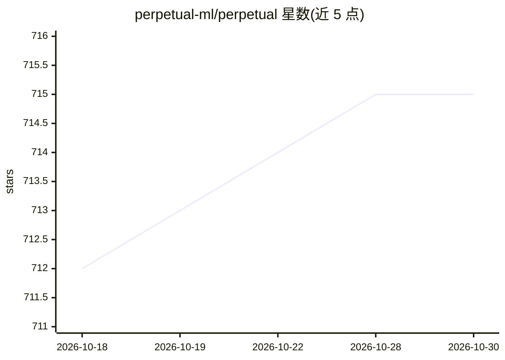

# perpetual-ml/perpetual

⭐ 715 · Rust · Apache-2.0 · 推送 2026-10-24 · [GitHub](https://github.com/perpetual-ml/perpetual) · [官网](https://perpetual-ml.com) · 组织维护

**免调参的梯度提升库：单次训练即可用的 Rust 核心 GBM**

Rust 实现的梯度提升机（PerpetualBooster），以单一 budget 参数替代超参数优化，预算增大提升泛化性能。支持二分类/多分类、回归与排序目标，原生处理类别变量、缺失值、单调与特征交互约束，内置因果 ML、持续学习、校准与漂移监控，可导出 XGBoost 或 ONNX 格式。提供 Python（pip/conda）、Rust（cargo）、R 三种语言绑定。README 附有与 LightGBM+Optuna 及 AutoGluon 的基准对比表；算法原理论文标注为进行中。

## 筛选速览

| 维度 | 判定 | 备注 |
|---|---|---|
| AI 角色 | `ai-native` | 本体是模型或模型工具 |
| 许可风险 | `permissive` | Apache-2.0 |
| 部署形态 | `library` | 以包/库形式分发 |
| 模型依赖 | — | README 未给出锁定关系 |
| 硬件要求 | — | 无带数字的原话,不猜 |
| 安装摩擦 | `low` | 无编译、无系统依赖或容器化 |
| 成熟度 | — | 结构信号不足 |

## 能力要点

- budget 单参数替代超参数优化，单次运行训练
- Rust 核心，零拷贝支持 Polars/Arrow 数据
- 内置因果 ML、持续学习（O(n²)→O(n)）、校准与漂移监控
- 支持分类/回归/排序，可导出 XGBoost 与 ONNX 格式

## 适用场景

- 表格数据的分类/回归建模且不想做超参数搜索
- 需要因果效应估计或漂移监测的生产模型
- 在 Python/R/Rust 环境中复用同一 GBM 实现

## 场景标签

 · 领域:机器学习/表格数据

## 证据(README 行号)

> L19: PerpetualBooster is a gradient boosting machine (GBM) that doesn't need hyperparameter optimization unlike other GB
> L24: - **High-Performance Rust Core:** Blazing-fast training and inference with a native Rust core, zero-copy support fo
> L25: - **Comprehensive Objectives:** Fully supports Classification (Binary & Multi-class), Regression, and Ranking tasks

## 星数曲线

2026-10-18 712 → 2026-10-30 715（+3）

---
*卡片 v1 · prompt 1.4 · 生成 2026-10-21 · 置信度 high · 依据 README sha `6add153ebbdf` · [字段定义](../../DATASET.md)*
