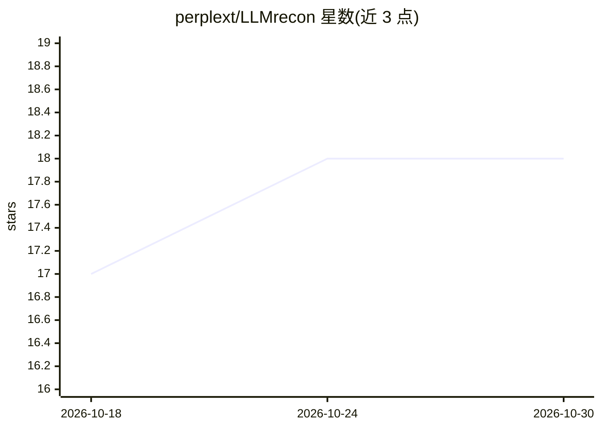

# perplext/LLMrecon

⭐ 18 · Go · MIT · 推送 2026-10-26 · [GitHub](https://github.com/perplext/LLMrecon) · 组织维护

**面向安全研究者的 LLM 红队测试框架，实现 OWASP LLM Top 10**

用 Python 与 Go 双语言实现的大模型安全测试框架：实现 OWASP Top 10 2025 十类漏洞测试，含 FlipAttack、DrAttack、Policy Puppetry 等攻击技术，支持自定义 YAML 攻击模板与基于多臂老虎机的攻击选择优化，并检测内容过滤、Prompt Guard 等防御机制。可测试 OpenAI、Anthropic、Google、Ollama 等平台模型。企业版 Go CLI 提供 Redis 分布式执行与 WebSocket 监控；部分功能（如 update apply 非实验路径）尚未实现，处于分阶段开发中。

## 筛选速览

| 维度 | 判定 | 备注 |
|---|---|---|
| AI 角色 | `ai-ecosystem` | LLM/agent 周边工具 |
| 许可风险 | `permissive` | MIT |
| 部署形态 | `self-host` | docker 或自建部署 |
| 模型依赖 | local-ok | 支持本地模型 |
| 硬件要求 | — | 无带数字的原话,不猜 |
| 安装摩擦 | `low` | 无编译、无系统依赖或容器化 |
| 成熟度 | `idea` | |

## 能力要点

- 覆盖 OWASP LLM Top 10 2025 十类漏洞的攻击与检测模块（50+ 攻击模块）
- 多臂老虎机 ML 优化自适应选择攻击技术
- 识别内容过滤、Prompt Guard、限流等防御机制
- Redis 分布式执行与 WebSocket 实时监控的企业架构

## 适用场景

- 对自部署或第三方 LLM 做 OWASP 合规的安全评估
- 红队测试中发现提示注入、系统提示泄露等漏洞
- 研究各类越狱/注入攻击技术在目标模型上的成功率

## 场景标签

`网络安全` · 领域:学习与行业

## 证据(README 行号)

> L19: LLMrecon is a comprehensive security testing framework designed to identify vulnerabilities in Large Language Model
> L28: - **Multi-Platform** - Test models from OpenAI, Anthropic, Google, Ollama, and more
> L89: **Real provider support** (OpenAI, Anthropic) for `attack run` is wired

## 星数曲线

2026-10-18 17 → 2026-10-30 18（+1）

---
*卡片 v1 · prompt 1.4 · 生成 2026-10-29 · 置信度 high · 依据 README sha `79389c2ea319` · [字段定义](../../DATASET.md)*
