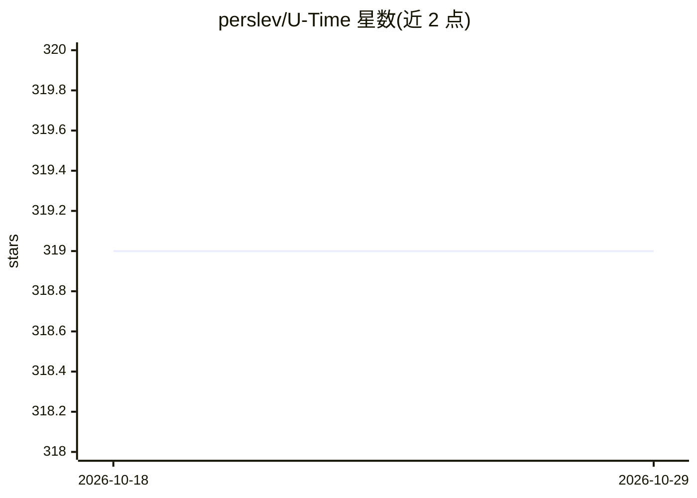

# perslev/U-Time

⭐ 319 · Python · MIT · 推送 2026-06-24 · [GitHub](https://github.com/perslev/U-Time) · 组织维护

**时间序列分割/睡眠分期的全卷积神经网络训练与评估工具**

U-Time/U-Sleep 模型的官方实现：提供用于时间序列分割与自动睡眠分期的全卷积深度神经网络，支持跨任意数量 PSG 数据集同时训练、输入通道组合随机选择，并通过命令行接口（ut init/fetch/train/predict 等）完成初始化、训练与评估而无需修改代码。面向希望复现、扩展或在自有数据上训练模型的研究者；推理可在笔记本 CPU 上运行，从头训练建议 Linux + CUDA GPU，完整复现约需 4 TiB 存储。预训练模型经由 sleep.ai.ku.dk 网页服务另行提供。

## 筛选速览

| 维度 | 判定 | 备注 |
|---|---|---|
| AI 角色 | `ai-native` | 本体是模型或模型工具 |
| 许可风险 | `permissive` | MIT |
| 部署形态 | `library` | 以包/库形式分发 |
| 模型依赖 | — | README 未给出锁定关系 |
| 硬件要求 | — | 无带数字的原话,不猜 |
| 安装摩擦 | `medium` | 含编译或系统依赖之一 |
| 成熟度 | — | 结构信号不足 |

## 能力要点

- U-Time/U-Sleep 全卷积网络官方实现（NeurIPS 2019 等）
- CLI 驱动的完整流程：数据下载、预处理、训练、预测、混淆矩阵评估
- 支持多 PSG 数据集同时训练与输入通道组合随机选择
- 数据预处理为 HDF5 并可流式加载以降低内存需求

## 适用场景

- 在自有 PSG 数据集上训练睡眠分期模型
- 复现 U-Sleep 论文实验结果
- 基于 U-Time 框架做通用时间序列分割研究

## 场景标签

`模型训练` · 领域:训练与推理

## 证据(README 行号)

> L20: U-Sleep is a fully convolutional deep neural network for automated sleep staging. A single instance of the model ma
> L23: This software allows simultaneous training of U-Sleep across any number of PSG datasets using on-the-fly random sel
> L33: This repository stores code for training and evaluating the *U-Sleep* sleep staging model. It builds upon and signi

## 星数曲线

2026-10-18 319 → 2026-10-29 319（+0）

---
*卡片 v1 · prompt 1.4 · 生成 2026-10-21 · 置信度 high · 依据 README sha `ce7a652bf4bd` · [字段定义](../../DATASET.md)*
