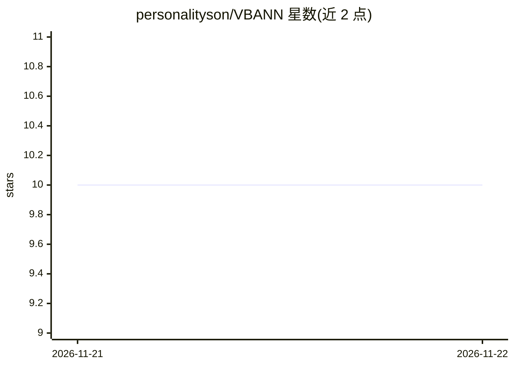

# personalityson/VBANN

⭐ 10 · VBA · CC0-1.0 · 推送 2026-11-12 · [GitHub](https://github.com/personalityson/VBANN) · 个人维护

**在 Excel 内用 VBA 搭建神经网络与梯度提升树的机器学习库**

VBANN 是一个用纯 VBA 实现的 PyTorch 风格机器学习框架，可在 Excel 的 .xlsm 文件内搭建神经网络与梯度提升树。数据、模型、训练器与优化器状态全部存于同一文件，模型保存到工作表可重新加载并继续训练；架构模块化可扩展，用户可添加自定义层类；通过在 TensorOps 模块中链接预编译 OpenBLAS dll 可获得 6-10 倍加速。采用 CC0 v1.0 许可，README 提供 VBA 快速示例代码。

## 筛选速览

| 维度 | 判定 | 备注 |
|---|---|---|
| AI 角色 | `ai-native` | 本体是模型或模型工具 |
| 许可风险 | `viral` | CC0-1.0 |
| 部署形态 | `None` |  |
| 模型依赖 | — | README 未给出锁定关系 |
| 硬件要求 | — | 无带数字的原话,不猜 |
| 安装摩擦 | `low` | 无编译、无系统依赖或容器化 |
| 成熟度 | — | 结构信号不足 |

## 能力要点

- 纯 VBA 实现神经网络与梯度提升树，运行于 Excel
- 数据、模型、训练器与优化器状态存于单一 .xlsm 文件，无需安装加载项
- 模型保存到工作表，支持重新加载后继续训练
- 可选链接预编译 OpenBLAS dll 提速 6-10 倍

## 适用场景

- 在 Excel 中直接训练和使用神经网络模型
- 在 .xlsm 内对表格数据做梯度提升树回归/分类
- 不安装加载项、不需要管理员权限的环境下运行机器学习流程

## 场景标签

`模型训练` · 领域:训练与推理

## 证据(README 行号)

> L4: - VBANN is a small PyTorch-style machine learning framework implemented in pure VBA, which can be used to set up neu
> L5: - VBANN is designed to store everything in the same file. No installs, no add-ins, no admin rights needed -- the who
> L12: Gradient-boosted trees:
> L20: A neural network:

## 星数曲线

2026-11-21 10 → 2026-11-22 10（+0）

---
*卡片 v1 · prompt 1.4 · 生成 2026-11-21 · 置信度 high · 依据 README sha `e4491dbfe930` · [字段定义](../../DATASET.md)*
