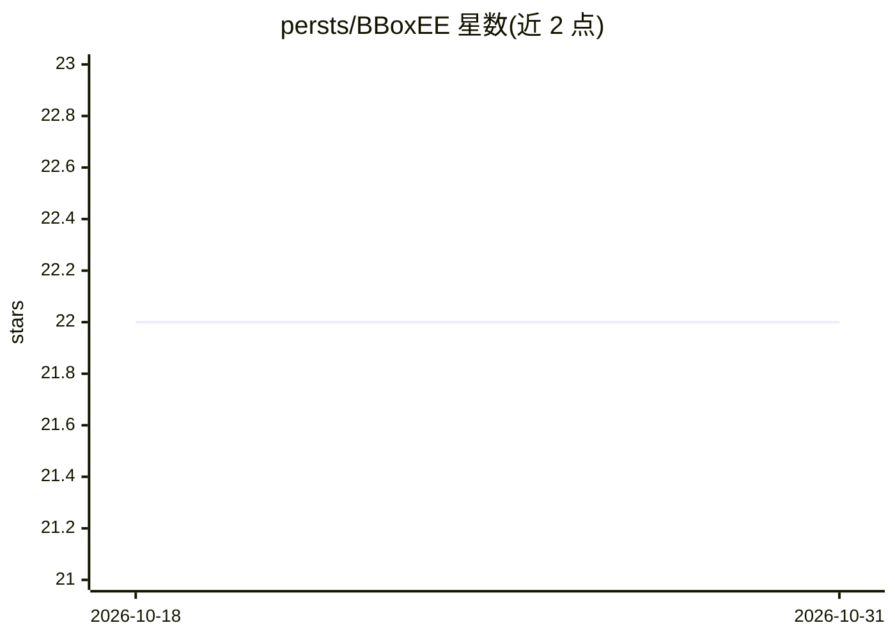

# persts/BBoxEE

⭐ 22 · Python · GPL-3.0 · 推送 2026-03-17 · [GitHub](https://github.com/persts/BBoxEE) · 组织维护

**边界框标注与导出工具，面向目标检测训练数据制作**

开源的边界框标注工具，支持标注结果导出用于训练目标检测模型。为 Animal Detection Network（Andenet）相机陷阱动物检测计划开发，但可用于任意边界框标注任务。技术栈为 Python 3.12 + PyQt6 桌面界面，依赖 Torch、yolov5、ultralytics 等库，通过源码方式安装（构建虚拟环境安装依赖后 python main.py 启动）。项目处于活跃开发中，作者为美国自然历史博物馆生物多样性与保护中心的 Peter Ersts，完整文档尚未发布。

## 筛选速览

| 维度 | 判定 | 备注 |
|---|---|---|
| AI 角色 | `ai-ecosystem` | LLM/agent 周边工具 |
| 许可风险 | `viral` | GPL-3.0 |
| 部署形态 | `None` |  |
| 模型依赖 | — | README 未给出锁定关系 |
| 硬件要求 | — | 无带数字的原话,不猜 |
| 安装摩擦 | `low` | 无编译、无系统依赖或容器化 |
| 成熟度 | `idea` | |

## 能力要点

- 边界框标注并导出为目标检测训练数据
- 面向相机陷阱动物检测（Andenet）场景开发，但不限于此
- PyQt6 桌面应用，Python 源码运行

## 适用场景

- 为相机陷阱影像标注动物边界框
- 为任意目标检测模型制作训练数据集

## 场景标签

 · 领域:计算机视觉/数据标注

## 证据(README 行号)

> L3: BBoxEE is a open-source tool for annotating bounding boxes and exporting data to training object detectors. BBoxEE w
> L20: * yolov5 (7.0.14)

## 星数曲线

2026-10-18 22 → 2026-10-31 22（+0）

---
*卡片 v1 · prompt 1.4 · 生成 2026-10-27 · 置信度 mid · 依据 README sha `671f2ed7693a` · [字段定义](../../DATASET.md)*
