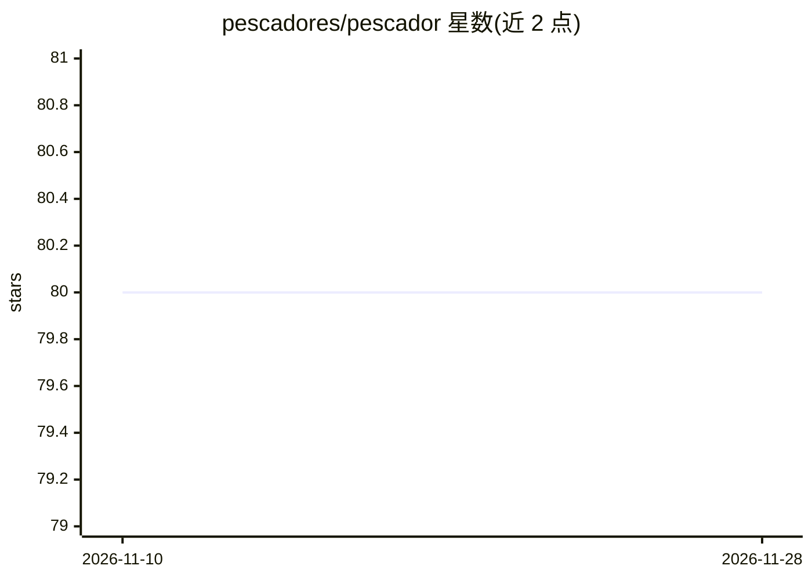

# pescadores/pescador

⭐ 80 · Python · ISC · 推送 2026-11-11 · [GitHub](https://github.com/pescadores/pescador) · [官网](https://pescador.readthedocs.io) · 组织维护

**机器学习场景的数值数据流式采样库**

Pescador 是一个 Python 流式数值数据处理库，面向机器学习应用中的数据采样需求。支持层级采样、核外学习与并行流式三种用例：可将多个数据源按任意指定分布动态交织为随机流，管理超出内存容量的大规模数据源工作集，并将数据生成移入后台进程以降低主线程延迟。通过 PyPI pip 与 conda-forge 渠道安装，并提供文档与 DOI。

## 筛选速览

| 维度 | 判定 | 备注 |
|---|---|---|
| AI 角色 | `ai-ecosystem` | LLM/agent 周边工具 |
| 许可风险 | `permissive` | ISC |
| 部署形态 | `library` | 以包/库形式分发 |
| 模型依赖 | — | README 未给出锁定关系 |
| 硬件要求 | — | 无带数字的原话,不猜 |
| 安装摩擦 | `low` | 无编译、无系统依赖或容器化 |
| 成熟度 | — | 结构信号不足 |

## 能力要点

- 多数据源按任意分布动态交织采样
- 管理小工作集支持核外学习
- 数据生成可移入后台进程实现并行流式

## 适用场景

- 多类别数据源合并为随机训练流
- 数据量超出内存时维持小工作集训练
- 数据加载有延迟时用后台进程预处理

## 场景标签

`MLOps` · 领域:训练与推理

## 证据(README 行号)

> L10: Pescador is a library for streaming (numerical) data, primarily for use in machine learning applications.
> L14: - **Hierarchical sampling**
> L15: - **Out-of-core learning**
> L16: - **Parallel streaming**

## 星数曲线

2026-11-10 80 → 2026-11-28 80（+0）

---
*卡片 v1 · prompt 1.4 · 生成 2026-11-18 · 置信度 high · 依据 README sha `19bf1c0a7d14` · [字段定义](../../DATASET.md)*
