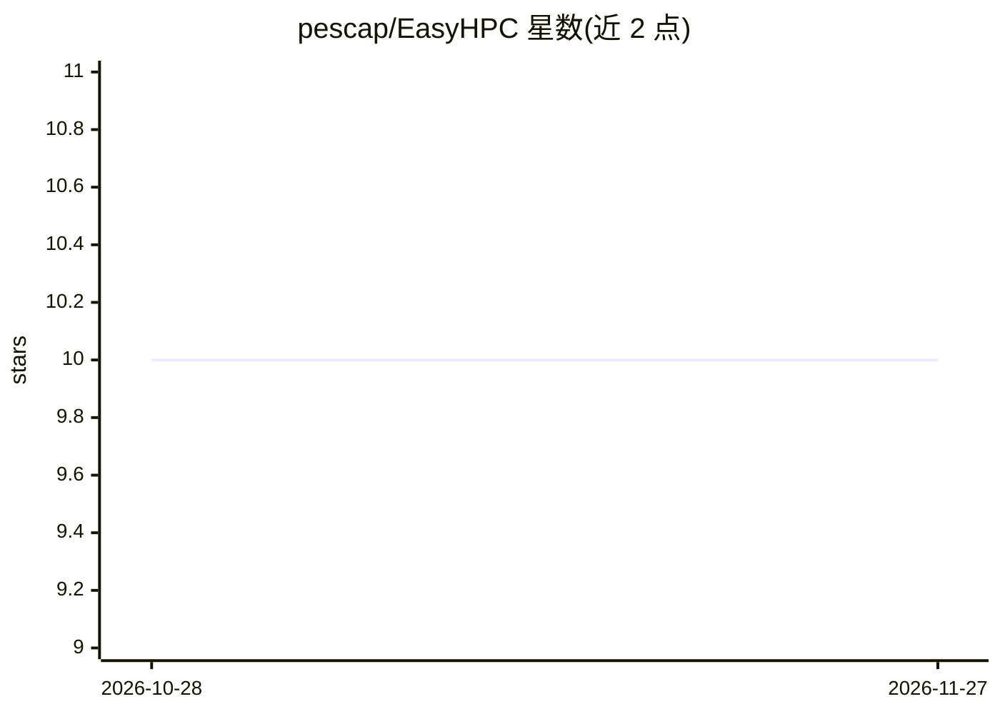

# pescap/EasyHPC

⭐ 10 · GPL-3.0 · 推送 2026-10-26 · [GitHub](https://github.com/pescap/EasyHPC) · 组织维护

**面向学生的 HPC 实践入门教程：跑通首个 HPC 深度学习项目**

一份以实践为导向的高性能计算入门文档，源自智利 Universidad Adolfo Ibáñez 2022 年本科研究课程共享笔记，托管于 Read the Docs。内容覆盖 GitHub 协作流程、CI/CD 文档构建（Sphinx/GitHub Actions）、Linux/SSH/远程 Jupyter/GPU/conda/Docker 系统管理，以及基于 Horovod 的分布式深度学习与 DeepXDE 物理信息神经网络，侧重深度学习与 PINN 方向。

## 筛选速览

| 维度 | 判定 | 备注 |
|---|---|---|
| AI 角色 | `ai-knowledge` | 知识聚合/清单类 |
| 许可风险 | `viral` | GPL-3.0 |
| 部署形态 | `None` |  |
| 模型依赖 | — | README 未给出锁定关系 |
| 硬件要求 | — | 无带数字的原话,不猜 |
| 安装摩擦 | `low` | 无编译、无系统依赖或容器化 |
| 成熟度 | — | 结构信号不足 |

## 能力要点

- 覆盖从 GitHub 协作到 CI/CD 文档构建的完整工作流
- 讲授远程服务器上的 Linux/SSH/Jupyter/GPU/conda/Docker 使用
- 包含 Horovod 分布式深度学习与 DeepXDE 物理信息神经网络实践
- 文档发布于 easyhpc.readthedocs.io

## 适用场景

- 首次接触 HPC 与远程 GPU 服务器的本科生学习路径
- 搭建 Sphinx/GitHub Actions 的科研文档工程
- 学习分布式深度学习训练与 PINN 建模

## 场景标签

`教程课程` `科研工具` · 领域:学习与行业

## 证据(README 行号)

> L8: A practical guide to your first High Performance Computing (HPC) project, with a focus on deep learning and physics-
> L17: - Distributed deep learning with Horovod
> L25: EasyHPC started in 2022 as the shared documentation of an undergraduate research course at Universidad Adolfo Ibáñe

## 星数曲线

2026-10-28 10 → 2026-11-27 10（+0）

---
*卡片 v1 · prompt 1.4 · 生成 2026-11-19 · 置信度 high · 依据 README sha `c3455cffb103` · [字段定义](../../DATASET.md)*
