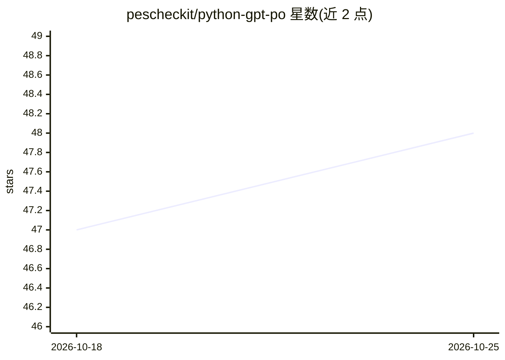

# pescheckit/python-gpt-po

⭐ 48 · Python · MIT · 推送 2026-03-03 · [GitHub](https://github.com/pescheckit/python-gpt-po) · 组织维护

**用 AI 模型批量翻译 gettext .po 文件的 Python 工具**

Python 包与 CLI 工具，读取 gettext .po 本地化文件并调用 LLM 生成翻译，支持 OpenAI、Azure OpenAI、Anthropic/Claude、DeepSeek 与 Ollama 五种 provider。机制上：利用 msgctxt 做上下文感知翻译，自动为 AI 译文打 `#. AI-generated` 注释标记，支持批量处理（可设批大小）、fuzzy 条目翻译修复、按目录结构自动检测目标语言。提供 PyPI 安装、Docker 镜像与源码安装三种途径，要求 Python 3.9+。限制：Django makemessages 会移除 AI 标记注释，需重跑恢复。

## 筛选速览

| 维度 | 判定 | 备注 |
|---|---|---|
| AI 角色 | `ai-native` | 本体是模型或模型工具 |
| 许可风险 | `permissive` | MIT |
| 部署形态 | `self-host` | docker 或自建部署 |
| 模型依赖 | local-ok | 支持本地模型 |
| 硬件要求 | — | 无带数字的原话,不猜 |
| 安装摩擦 | `low` | 无编译、无系统依赖或容器化 |
| 成熟度 | — | 结构信号不足 |

## 能力要点

- 支持 OpenAI/Azure/Anthropic/DeepSeek/Ollama 五种 AI provider
- 基于 msgctxt 的上下文感知翻译与默认上下文设置
- AI 译文自动打 `#. AI-generated` 标记，支持增量翻译工作流
- 批量翻译（默认每批 50 条）与 fuzzy 条目处理、语言自动检测

## 适用场景

- 开源项目或应用的多语言 .po 文件批量翻译
- 本地化流程中标记并追踪 AI 生成的译文
- 配合本地 Ollama 离线翻译 .po 文件

## 场景标签

`AI 写作` · 领域:内容生成

## 证据(README 行号)

> L7: **Translate gettext (.po) files using AI models.** Supports OpenAI, Azure OpenAI, Anthropic/Claude, and DeepSeek wit
> L20: - **Multiple AI providers** - OpenAI, Azure OpenAI, Anthropic/Claude, DeepSeek, Ollama

## 星数曲线

2026-10-18 47 → 2026-10-25 48（+1）

---
*卡片 v1 · prompt 1.4 · 生成 2026-10-25 · 置信度 high · 依据 README sha `389f40689af8` · [字段定义](../../DATASET.md)*
