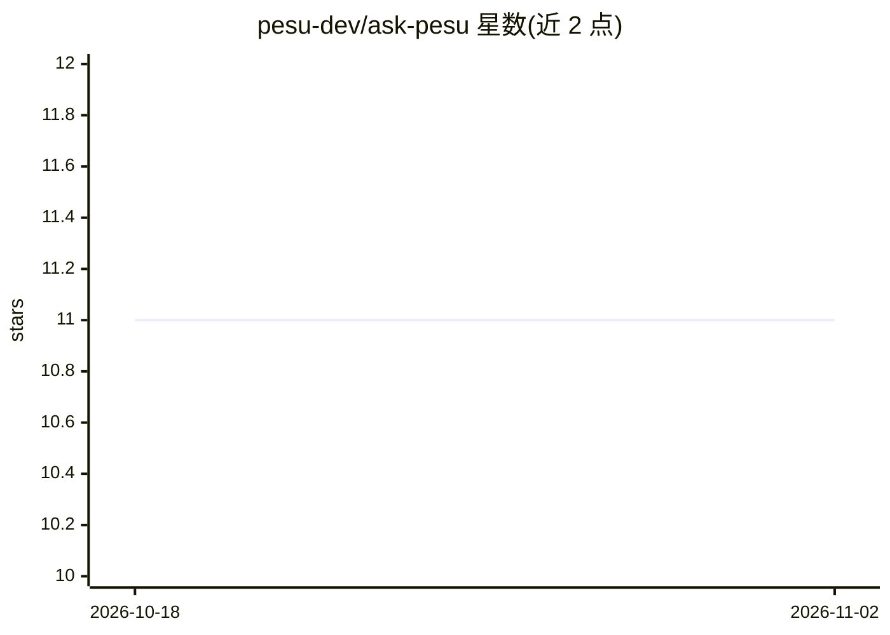

# pesu-dev/ask-pesu

⭐ 11 · TypeScript · MIT · 推送 2026-10-02 · [GitHub](https://github.com/pesu-dev/ask-pesu) · [官网](https://huggingface.co/spaces/pesu-dev/askpesu) · 组织维护

**面向 PES University 的 RAG 问答系统，基于 r/PESU 讨论数据**

由 api 与 db 两个服务组成的 monorepo：db 服务将 r/PESU 评论线程以 dense + BM25 向量索引进 Qdrant 并支持回填历史；api 服务基于 FastAPI + LangChain 检索这些线程，流式返回回答及其引用来源，并附带 React 前端。部署于 Hugging Face Spaces，可用 ENV=test 无凭证运行 canned answers；真实问答需配置 Qdrant 与 HF_TOKEN，本地可用 ollama。面向该校学生与开发者，MIT 许可。

## 筛选速览

| 维度 | 判定 | 备注 |
|---|---|---|
| AI 角色 | `ai-native` | 本体是模型或模型工具 |
| 许可风险 | `permissive` | MIT |
| 部署形态 | `None` |  |
| 模型依赖 | local-ok | 支持本地模型 |
| 硬件要求 | — | 无带数字的原话,不猜 |
| 安装摩擦 | `low` | 无编译、无系统依赖或容器化 |
| 成熟度 | — | 结构信号不足 |

## 能力要点

- db 服务以 dense + BM25 向量将 r/PESU 线程索引进 Qdrant
- api 服务流式返回回答及所引用的线程
- uv 管理依赖（Python 3.12），支持本地 ollama 与 Docker

## 适用场景

- 向 PES University 相关问题并得到带 Reddit 讨论出处的回答
- 持续接入新 r/PESU 讨论并回填历史索引
- 以 ENV=test 模式无凭证体验带 UI 的回答流程

## 场景标签

 · 领域:LLM 应用/RAG 问答

## 证据(README 行号)

> L3: A retrieval-augmented question answering system for PES University, answering from
> L10: |`services/api`|**AskPESU**|Answers questions: a FastAPI + LangChain RAG backend, and the React frontend it serves|
> L22: The db service indexes r/PESU threads into Qdrant. The api service searches them for each question

## 星数曲线

2026-10-18 11 → 2026-11-02 11（+0）

---
*卡片 v1 · prompt 1.4 · 生成 2026-11-02 · 置信度 high · 依据 README sha `a945267f10d0` · [字段定义](../../DATASET.md)*
