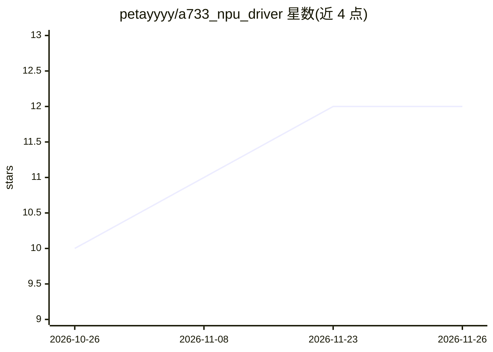

# petayyyy/a733_npu_driver

⭐ 12 · Python · MIT · 推送 2026-06-25 · [GitHub](https://github.com/petayyyy/a733_npu_driver) · 个人维护

**在 Allwinner A733 NPU 上运行小型 LLM/VLM 推理的工具链与指南**

面向 Allwinner A733（Vivante VIP9000）板卡的项目记录与工具集：提供 ONNX→ACUITY→NBG 的可复现模型转换工具链、板卡 NPU 启动文档、CLI 聊天工具与基准数据。在 NPU 上运行 SmolLM2-135M/360M 与 MobileCLIP-S0 视觉编码器；Qwen 级模型走 CPU 的 llama.cpp 路径，推荐 NPU 视觉+CPU 语言模型的混合架构。文档明确列出无法在 NPU 运行的模型配置及原因，无 KV-cache，仅支持短固定窗口（W≤64）。

## 筛选速览

| 维度 | 判定 | 备注 |
|---|---|---|
| AI 角色 | `ai-native` | 本体是模型或模型工具 |
| 许可风险 | `permissive` | MIT |
| 部署形态 | `None` |  |
| 模型依赖 | local-ok | 支持本地模型 |
| 硬件要求 | — | 无带数字的原话,不猜 |
| 安装摩擦 | `low` | 无编译、无系统依赖或容器化 |
| 成熟度 | — | 结构信号不足 |

## 能力要点

- ONNX→ACUITY→NBG→VIPLite 可复现转换工具链
- SmolLM2-135M（21 tok/s）与 MobileCLIP-S0（22.6 ms/帧）在 NPU 上运行
- CLI 图像聊天与文本聊天工具（vlm_chat.py / llm_chat.py）
- 文档化失败配置清单（Qwen2.5-0.5B、SmolLM2-1.7B 导出失败原因）

## 适用场景

- 在 A733 板卡上部署小型模型的本地聊天与图像理解
- 为 VIP9000 NPU 转换自己的 ONNX 模型
- 评估该 NPU 对 LLM 推理的能力边界

## 场景标签

`推理引擎` · 领域:训练与推理

## 证据(README 行号)

> L9: We attempted to run real LLM/VLM inference NPU-only on the Allwinner A733
> L13: fully reproducible toolchain (ONNX → ACUITY → NBG → VIPLite → board) with
> L82: |**VLM image chat (CLI)**|app/README.md — `python3 app/vlm_chat.py --image dog.jpg`|

## 星数曲线

2026-10-26 10 → 2026-11-26 12（+2）

---
*卡片 v1 · prompt 1.4 · 生成 2026-11-18 · 置信度 high · 依据 README sha `bafba045beab` · [字段定义](../../DATASET.md)*
