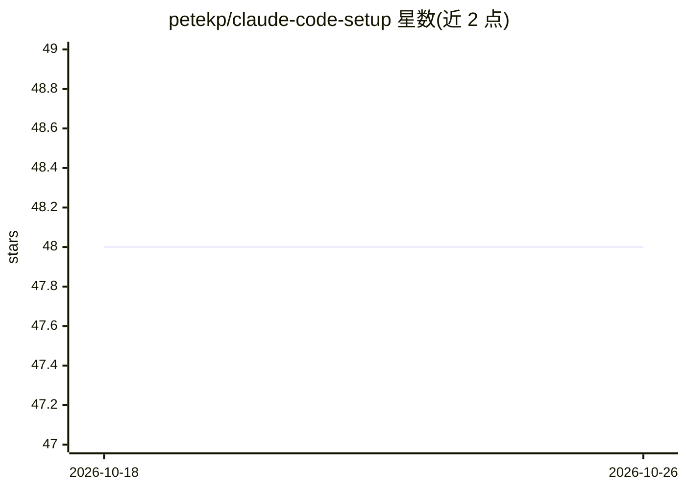

# petekp/claude-code-setup

⭐ 48 · Shell · MIT · 推送 2026-10-25 · [GitHub](https://github.com/petekp/claude-code-setup) · 个人维护

**可 fork 的 Claude Code/Codex 配置集：技能与脚本一键链接同步**

个人维护的 Claude Code 与 OpenAI Codex 配置仓库，包含技能（skills）、hook 脚本、Claude Code mods 与 setup.sh 安装脚本。setup.sh 在两个工具的技能目录间创建符号链接，支持 --undo 回滚与 skill-doctor.sh 健康检查；settings-snapshot.sh 复制或对比设置快照，用于跨机器同步。无构建步骤，仅含 shell 脚本、Markdown 与 TypeScript。设计为 fork 后替换为用户自己的技能与设置。

## 筛选速览

| 维度 | 判定 | 备注 |
|---|---|---|
| AI 角色 | `ai-ecosystem` | LLM/agent 周边工具 |
| 许可风险 | `permissive` | MIT |
| 部署形态 | `library` | 以包/库形式分发 |
| 模型依赖 | — | README 未给出锁定关系 |
| 硬件要求 | — | 无带数字的原话,不猜 |
| 安装摩擦 | `low` | 无编译、无系统依赖或容器化 |
| 成熟度 | — | 结构信号不足 |

## 能力要点

- setup.sh 将技能链接到 ~/.claude/skills 与 ~/.codex/skills，支持 --undo
- skill-doctor.sh 报告断链、缺 SKILL.md 的技能与设置差异
- settings-snapshot.sh 复制/对比设置快照，新机器可自动恢复
- inbox mod 收集会话中 agent 提问、问题与 PR 检查状态

## 适用场景

- 我 fork 后维护自己的 Claude Code/Codex 技能集并跨机器同步
- 我需要检查 agent 技能链接与设置的健康状态
- 我想统计各技能在会话中的使用频率

## 场景标签

 · 领域:AI 编程助手配置/开发工具

## 证据(README 行号)

> L3: My configuration for Claude Code and OpenAI Codex: skills, hook scripts, Claude
> L42: `mods/` holds Claude Code mods: plugins whose TypeScript hooks run inside

## 星数曲线

2026-10-18 48 → 2026-10-26 48（+0）

---
*卡片 v1 · prompt 1.4 · 生成 2026-10-25 · 置信度 mid · 依据 README sha `de83144cc1f2` · [字段定义](../../DATASET.md)*
