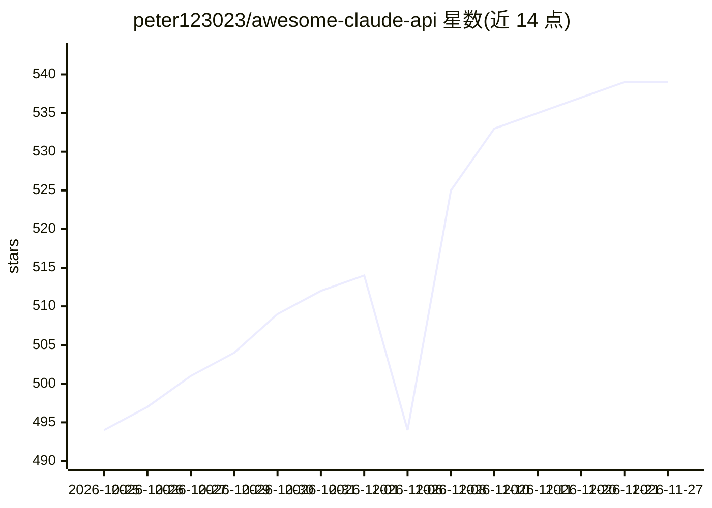

# peter123023/awesome-claude-api

⭐ 539 · MIT · 推送 2026-11-08 · [GitHub](https://github.com/peter123023/awesome-claude-api) · [官网](https://panovast.com/claude-api-relay) · 个人维护 · 中文 README

**为开发者汇总 Claude/OpenAI 中转 API 渠道资源清单**

以 awesome-list 形式维护的 Claude 中转 API 资源汇总：按月更新各渠道访问量数据（对比相邻两月增减），以表格列出服务商的费用结构、支持模型、兼容协议（Anthropic/OpenAI 双协议、Claude Code 接入）与标签，并附使用说明、检测工具、贡献指南与免责声明。所有服务为第三方中转，README 提示用户先阅读服务商条款、试用后再付费。数据来源标注为各服务商官方网站。

## 筛选速览

| 维度 | 判定 | 备注 |
|---|---|---|
| AI 角色 | `ai-knowledge` | 知识聚合/清单类 |
| 许可风险 | `permissive` | MIT |
| 部署形态 | `None` |  |
| 模型依赖 | — | README 未给出锁定关系 |
| 硬件要求 | — | 无带数字的原话,不猜 |
| 安装摩擦 | `low` | 无编译、无系统依赖或容器化 |
| 成熟度 | — | 结构信号不足 |

## 能力要点

- 按月对比覆盖 23 个渠道的月访问量增减数据
- 表格化列出费用结构、兼容协议与 Claude Code/Codex 等客户端接入方式
- 附第三方实测数据引用与待核实项标注（如运营主体未公开）
- 提供检测工具与贡献指南章节

## 适用场景

- 寻找支持 Claude Code 或 Codex 的中转 API 渠道
- 对比各中转服务的计费方式与人民币充值途径
- 查看各渠道访问量变化以了解收录名单更新

## 场景标签

`精选清单` `模型网关` · 领域:Agent 开发

## 证据(README 行号)

> L10: 精心收集和整理的可靠Claude中转API资源列表，帮助开发者快速找到稳定、高性价比的Claude API服务。所有信息均来自官方网站，确保时效性和准确性。
> L28: 本项目致力于收集全球范围内稳定可靠的Claude中转API服务，为开发者提供一个权威、更新及时的资源参考。所有收录的API服务均经过初步筛选，确保具备基本的可用性和稳定性。
> L36: ## 🔌 API列表

## 星数曲线

2026-10-25 494 → 2026-11-27 539（+45）

---
*卡片 v1 · prompt 1.4 · 生成 2026-11-25 · 置信度 high · 依据 README sha `a05a2aa225e2` · [字段定义](../../DATASET.md)*
