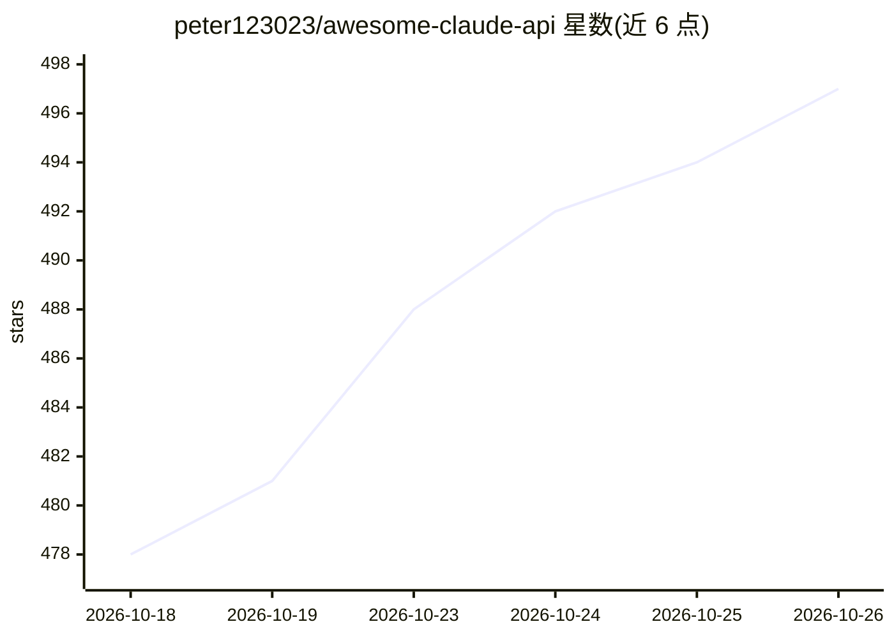

# peter123023/awesome-claude-api

⭐ 497 · MIT · 推送 2026-10-24 · [GitHub](https://github.com/peter123023/awesome-claude-api) · 个人维护 · 中文 README

**Claude 中转 API 服务商与检测工具的策展清单**

收集全球范围内提供 Claude API 中转能力的服务商资源清单，按表格列出 20 个渠道的网站地址、费用结构、月访问量变化（第三方流量平台估算）与标签，另收录 3 个中转站模型验真检测工具。信息来自官方渠道并按月更新访问量数据，接受 PR 贡献新增条目。清单本身不做安装分发，声明不对第三方服务质量做担保，使用者需自行核验并承担风险。

## 筛选速览

| 维度 | 判定 | 备注 |
|---|---|---|
| AI 角色 | `ai-knowledge` | 知识聚合/清单类 |
| 许可风险 | `permissive` | MIT |
| 部署形态 | `None` |  |
| 模型依赖 | — | README 未给出锁定关系 |
| 硬件要求 | — | 无带数字的原话,不猜 |
| 安装摩擦 | `low` | 无编译、无系统依赖或容器化 |
| 成熟度 | — | 结构信号不足 |

## 能力要点

- 20 个中转渠道含费用结构与月访问量对比数据
- 收录 3 个 API 中转站模型验真检测工具
- 按月更新收录与访问量数据，移除停服渠道
- 接受 PR 贡献，要求信息来自官方渠道

## 适用场景

- 挑选支持 Claude 全系列的 API 中转服务商
- 对比各中转渠道的计费方式与访问量变化
- 用检测工具核验中转站模型是否真实

## 场景标签

`精选清单` · 领域:学习与行业

## 证据(README 行号)

> L8: 精心收集和整理的可靠Claude中转API资源列表，帮助开发者快速找到稳定、高性价比的Claude API服务。所有信息均来自官方网站，确保时效性和准确性。
> L28: 本项目致力于收集全球范围内稳定可靠的Claude中转API服务，为开发者提供一个权威、更新及时的资源参考。所有收录的API服务均经过初步筛选，确保具备基本的可用性和稳定性。

## 星数曲线

2026-10-18 478 → 2026-10-26 497（+19）

---
*卡片 v1 · prompt 1.4 · 生成 2026-10-22 · 置信度 high · 依据 README sha `243ff9e3a661` · [字段定义](../../DATASET.md)*
