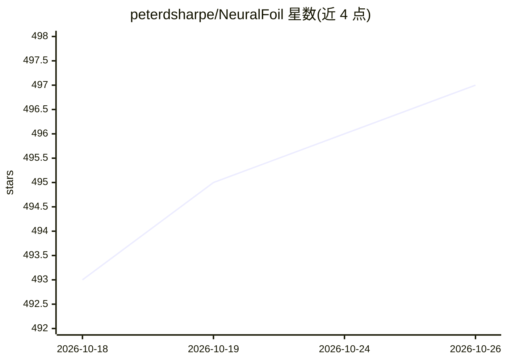

# peterdsharpe/NeuralFoil

⭐ 497 · Python · MIT · 推送 2026-10-07 · [GitHub](https://github.com/peterdsharpe/NeuralFoil) · 个人维护

**给飞机设计者的翼型气动快速分析工具，机器学习替代 XFoil**

基于物理信息机器学习与解析模型混合的翼型气动分析库，核心网络在近 800 万次 XFoil 运行数据上训练，以纯 Python+NumPy 运行（训练用 PyTorch）。提供 8 个不同规模模型（xxsmall~xxxlarge），输出升力/阻力/力矩系数、转捩位置、边界层信息，并附带 analysis_confidence 不确定度输出；单次分析约 1.2-6.1 毫秒，向量化批处理。支持全攻角、任意雷诺数、控制面偏转；跨声速/超声速与失速后特性需配合 AeroSandbox 使用。

## 筛选速览

| 维度 | 判定 | 备注 |
|---|---|---|
| AI 角色 | `ai-native` | 本体是模型或模型工具 |
| 许可风险 | `permissive` | MIT |
| 部署形态 | `library` | 以包/库形式分发 |
| 模型依赖 | — | README 未给出锁定关系 |
| 硬件要求 | — | 无带数字的原话,不猜 |
| 安装摩擦 | `medium` | 含编译或系统依赖之一 |
| 成熟度 | — | 结构信号不足 |

## 能力要点

- 8 个模型规模可选，精度与计算成本可权衡
- 输出 analysis_confidence 自评可信度，可用于鲁棒设计优化
- 近 800 万次 XFoil 运行训练，嵌入物理不变量
- 纯 Python+NumPy 运行，依赖极少，用户可见代码 <500 行

## 适用场景

- 翼型设计与气动优化中快速替代 XFoil 求升阻力
- 梯度优化中用 C∞ 连续输出与不确定度约束做鲁棒设计
- 批量多点气动分析（10 万次运行约秒级）
- 风机叶片/螺旋桨根部大攻角工况分析（配合 AeroSandbox）

## 场景标签

 · 领域:航空航天/气动工程

## 证据(README 行号)

> L10: **NeuralFoil** is a tool for rapid aerodynamics analysis of airfoils, similar to XFoil. NeuralFoil is a hybrid of p
> L12: NeuralFoil is available here as a pure Python+NumPy standalone (trained in PyTorch, runtime-executed in NumPy), but

## 星数曲线

2026-10-18 493 → 2026-10-26 497（+4）

---
*卡片 v1 · prompt 1.4 · 生成 2026-10-21 · 置信度 high · 依据 README sha `b00ebf8896dd` · [字段定义](../../DATASET.md)*
