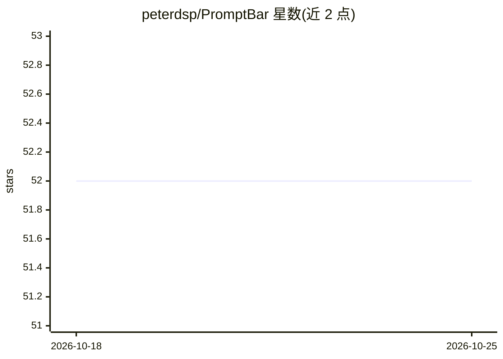

# peterdsp/PromptBar

⭐ 52 · Swift · NOASSERTION · 推送 2026-10-16 · [GitHub](https://github.com/peterdsp/PromptBar) · [官网](https://promptbar.peterdsp.dev) · 个人维护

**macOS 菜单栏 AI 聊天容器：封装任意网页聊天与 BYO Key API 端点**

SwiftUI 编写的 macOS 菜单栏应用，默认不内置任何服务商：用户可粘贴 URL 将任意网页聊天包装进无边弹窗，或配置任意 OpenAI 兼容 /chat/completions 端点（自带 Base URL、模型名、API Key）进行原生流式对话；API Key 存于 macOS 钥匙串，消息直连用户端点、无中转。另含跨会话的提示词库（搜索/标签）、每服务自定义图标与颜色、常驻置顶、一键清理 WebKit 数据，且无分析/遥测/远程配置。要求 macOS 26.0+，提供签名公证的 .pkg 安装包，也可用 Xcode 26+ 从源码构建。

## 筛选速览

| 维度 | 判定 | 备注 |
|---|---|---|
| AI 角色 | `ai-ecosystem` | LLM/agent 周边工具 |
| 许可风险 | `none` | NOASSERTION |
| 部署形态 | `desktop` | 安装包/桌面程序 |
| 模型依赖 | — | README 未给出锁定关系 |
| 硬件要求 | — | 无带数字的原话,不猜 |
| 安装摩擦 | `low` | 无编译、无系统依赖或容器化 |
| 成熟度 | — | 结构信号不足 |

## 能力要点

- 封装任意网页聊天 + 原生连接任意 OpenAI 兼容端点（BYO Key，SSE 流式）
- 默认空置：不内置服务商、Logo 或品牌名，由用户自行添加
- API Key 存于 macOS Keychain，无分析、无遥测、无远程配置
- 提示词库（搜索/标签，跨聊天复用）与一键清理 WebKit 本地数据

## 适用场景

- 把常用的多个 AI 网页聊天收进菜单栏，快捷键 ⌥⌘O 随时唤起
- 用自己的 API Key 在本地 Mac 上直连任意 OpenAI 兼容端点聊天
- 统一保存和复用高频提示词

## 场景标签

`聊天机器人` `提示工程` · 领域:Agent 开发

## 证据(README 行号)

> L27: 1. **Wraps any web-based chat** you point it at in a clean, distraction-free popover.
> L28: 2. **Talks natively to any OpenAI-compatible API endpoint** you configure, your key, your model, your endpoint, you
> L60: PromptBar speaks the **OpenAI-compatible `POST /chat/completions` schema**, the de-facto standard supported by the 

## 星数曲线

2026-10-18 52 → 2026-10-25 52（+0）

---
*卡片 v1 · prompt 1.4 · 生成 2026-10-24 · 置信度 high · 依据 README sha `8287f352c877` · [字段定义](../../DATASET.md)*
