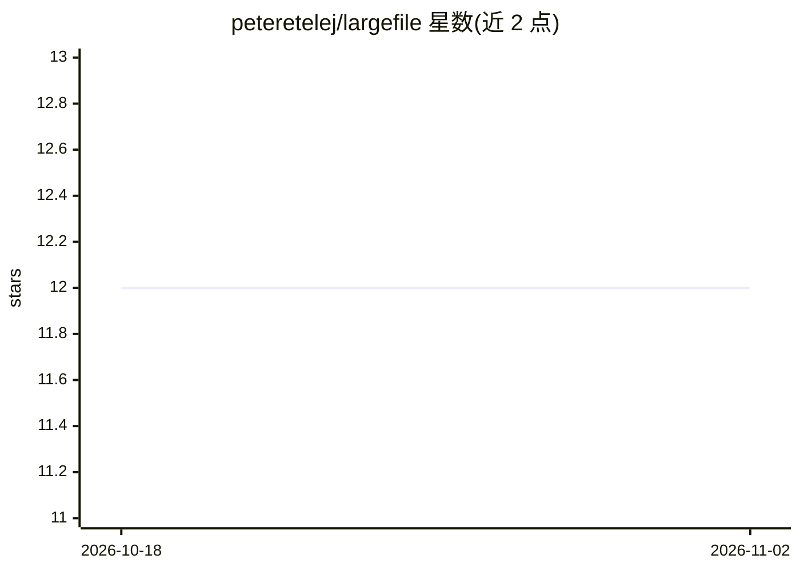

# peteretelej/largefile

⭐ 12 · Python · 推送 2026-04-09 · [GitHub](https://github.com/peteretelej/largefile) · 个人维护

**MCP 服务器：让 AI 读取搜索编辑超出上下文窗口的大文件**

面向 LLM/agent 的 MCP server，提供 7 个工具（get_overview、search_content、read_content、edit_content、revert_edit、list_directory、search_directory），用于浏览、搜索和编辑超过 AI 上下文限制的代码库、日志与数据文件。基于 Tree-sitter 提取 Python/JS/TS/Rust/Go/Java 的语义结构，其他文件类型回退到文本分析；通过 RAM→mmap→流式的分层内存策略支持多 GB 文件；编辑采用搜索/替换方式并自动备份。需 Python 3.10+ 与 uv（uvx 命令）运行。

## 筛选速览

| 维度 | 判定 | 备注 |
|---|---|---|
| AI 角色 | `ai-ecosystem` | LLM/agent 周边工具 |
| 许可风险 | `permissive` | — |
| 部署形态 | `library` | 以包/库形式分发 |
| 模型依赖 | — | README 未给出锁定关系 |
| 硬件要求 | — | 无带数字的原话,不猜 |
| 安装摩擦 | `low` | 无编译、无系统依赖或容器化 |
| 成熟度 | — | 结构信号不足 |

## 能力要点

- Tree-sitter 语义导航，支持 Python/JS/TS/Rust/Go/Java 六种语言
- 分层内存策略（RAM→mmap→流式）处理多 GB 文件
- 搜索/替换式编辑并自动备份，可 revert_edit 回滚
- 支持模糊、正则、大小写不敏感、反向、仅计数等搜索模式

## 适用场景

- 让 AI 助手分析超大日志文件的近期条目（tail 模式）
- 在超出上下文窗口的大型代码库中导航与批量重构
- 跨目录搜索模式而无需加载完整内容

## 场景标签

 · 领域:LLM 基础设施/MCP 工具

## 证据(README 行号)

> L1: # Largefile MCP Server
> L3: Navigate, search, and edit large codebases, logs, and data files that exceed AI context limits.
> L10: - **Semantic code navigation** - Tree-sitter extracts functions/classes for Python, JS/TS, Rust, Go

## 星数曲线

2026-10-18 12 → 2026-11-02 12（+0）

---
*卡片 v1 · prompt 1.4 · 生成 2026-11-01 · 置信度 high · 依据 README sha `cc6ae36194e9` · [字段定义](../../DATASET.md)*
