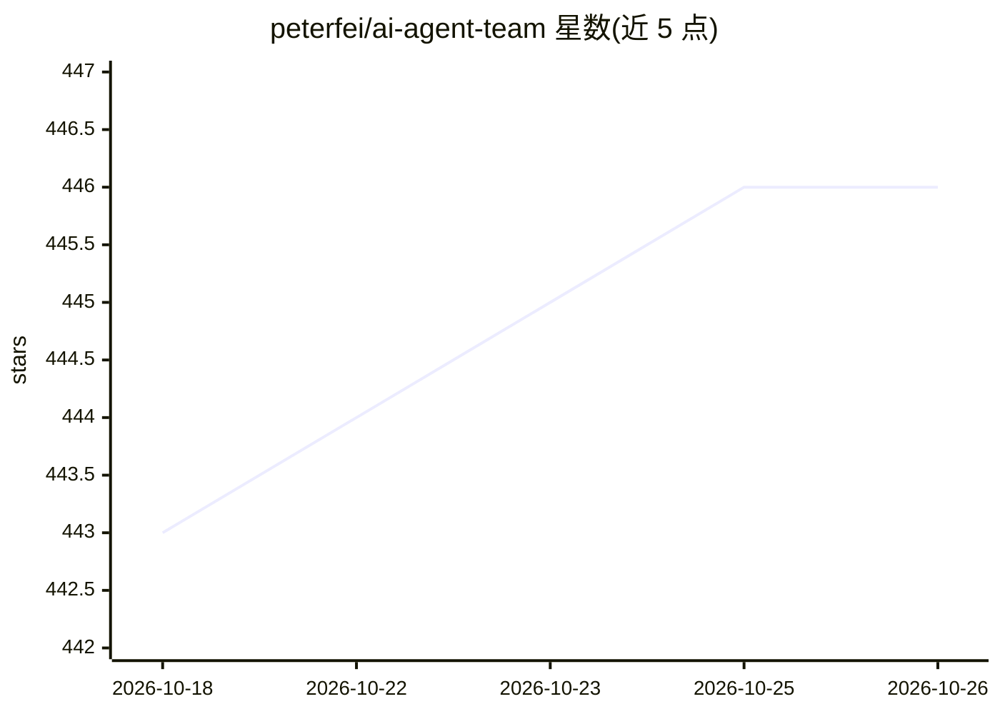

# peterfei/ai-agent-team

⭐ 446 · JavaScript · MIT · 推送 2026-06-29 · [GitHub](https://github.com/peterfei/ai-agent-team) · 个人维护 · 中文 README

**面向 Claude Code 的多角色 AI 开发团队技能与线程记忆套件**

基于 Claude Code 原生智能体系统的技能合集：提供产品经理、前端/后端/全栈、测试、DevOps、技术负责人等 7 个角色智能体，各技能可经 npx skills install 独立安装到任意项目，兼容 Cursor/Codex CLI/Gemini CLI 等 50+ 运行时。核心组件 Thread Manager 为 MCP 服务器，内置 Xenova/all-MiniLM-L6-v2 向量模型实现离线语义搜索、任务线程持久化、上下文恢复与自动 Git 版本控制（安装包 16-25MB）。另含变更日志生成、软著材料生成、桌面整理、笔记可视化技能。限制：需预装 Claude Code 与 Git；中英文命令混合。

## 筛选速览

| 维度 | 判定 | 备注 |
|---|---|---|
| AI 角色 | `ai-ecosystem` | LLM/agent 周边工具 |
| 许可风险 | `permissive` | MIT |
| 部署形态 | `library` | 以包/库形式分发 |
| 模型依赖 | locked-api |  |
| 硬件要求 | — | 无带数字的原话,不猜 |
| 安装摩擦 | `low` | 无编译、无系统依赖或容器化 |
| 成熟度 | — | 结构信号不足 |

## 能力要点

- 7 个角色智能体（PM/前端/后端/全栈/QA/DevOps/TL）可独立安装
- Thread Manager MCP 服务器：离线语义搜索、线程持久化、自动 Git 分支
- 各技能经 npx skills install 装入任意项目，兼容 50+ 运行时
- 附加技能：Changelog 生成、软著材料生成、桌面整理、笔记可视化

## 适用场景

- 在 Claude Code 中按角色启动产品/开发/测试工作流
- 跨会话恢复任务线程并管理 AI 对话记忆
- 自动生成变更日志或软著申请文档
- 整理桌面文件并生成可视化笔记图片

## 场景标签

`编码 Agent` `Agent 记忆` · 领域:Agent 开发

## 证据(README 行号)

> L43: - ⚡ **原生集成** - 完全基于 Claude Code 原生智能体系统，支持自定义扩展
> L31: 兼容 Claude Code / Cursor / Codex CLI / Gemini CLI / Windsurf 等 50+ 运行时。
> L66:     Agent -->|调用工具| MCP[Thread Manager MCP Server]

## 星数曲线

2026-10-18 443 → 2026-10-26 446（+3）

---
*卡片 v1 · prompt 1.4 · 生成 2026-10-21 · 置信度 high · 依据 README sha `b6fac1ae906e` · [字段定义](../../DATASET.md)*
