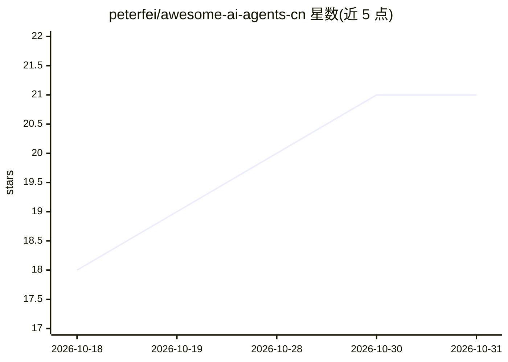

# peterfei/awesome-ai-agents-cn

⭐ 21 · 推送 2026-06-02 · [GitHub](https://github.com/peterfei/awesome-ai-agents-cn) · [官网](https://github.com/peterfei/awesome-ai-agents-cn) · 个人维护 · 中文 README

**中文 AI Agent 落地案例精选清单，覆盖 12 类应用场景**

一个中文社区维护的 AI Agent 实践案例 awesome 清单：按客服对话、开发工程、数据分析、RAG 知识库、内容办公、销售营销、流程自动化、安全合规、行业垂直、多 Agent 协作、运维部署等 12 个类别组织约 30 个案例，每个条目标注技术栈与难度星级，并附技术栈索引表映射工具到案例。贡献要求案例为亲身使用且含效果数据。MIT 许可，仓库本身不含代码实现。

## 筛选速览

| 维度 | 判定 | 备注 |
|---|---|---|
| AI 角色 | `ai-knowledge` | 知识聚合/清单类 |
| 许可风险 | `permissive` | — |
| 部署形态 | `None` |  |
| 模型依赖 | — | README 未给出锁定关系 |
| 硬件要求 | — | 无带数字的原话,不猜 |
| 安装摩擦 | `low` | 无编译、无系统依赖或容器化 |
| 成熟度 | — | 结构信号不足 |

## 能力要点

- 12 个业务类别组织约 30 个 Agent 落地案例
- 每个案例标注技术栈组合与难度星级（★☆☆~★★★）
- 技术栈索引表映射 Claude Code/Dify/LangChain/n8n 等工具到具体案例
- 贡献门槛要求亲身使用经验与效果数据

## 适用场景

- 寻找特定业务场景（客服、RAG、运维等）的 Agent 技术方案参考
- 按技术栈（如 Claude Code + MCP、LangChain + Ollama）检索已落地案例
- 评估不同 Agent 框架在实际项目中的使用方式

## 场景标签

`精选清单` · 领域:学习与行业

## 证据(README 行号)

> L3: > 中文 AI Agent 落地案例精选 —— 真实场景、真实代码、真实效果。
> L13: - 每个案例回答：**解决什么问题？用了什么方案？效果如何？**
> L18: ## 案例分类

## 星数曲线

2026-10-18 18 → 2026-10-31 21（+3）

---
*卡片 v1 · prompt 1.4 · 生成 2026-10-28 · 置信度 high · 依据 README sha `1c225b1a930c` · [字段定义](../../DATASET.md)*
