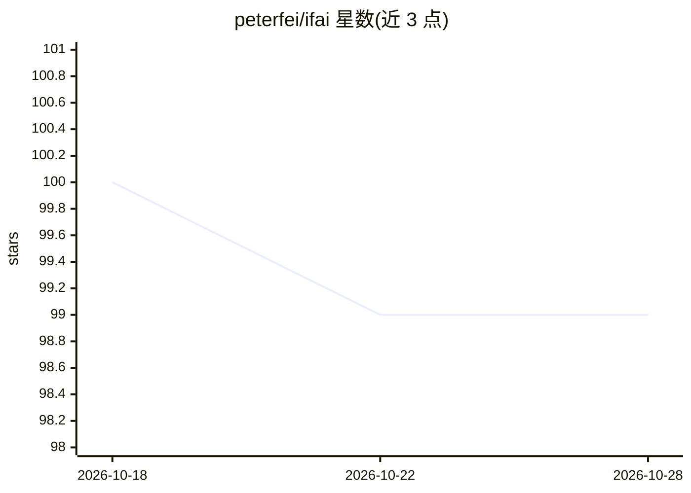

# peterfei/ifai

⭐ 99 · TypeScript · NOASSERTION · 推送 2026-06-10 · [GitHub](https://github.com/peterfei/ifai) · [官网](https://docs.ifai.today) · 个人维护 · 中文 README

**面向开发者的 AI Agent 编排助手与代码编辑器（Tauri 2.0）**

基于 Tauri 2.0 + React 19 + Rust 内核的 AI 原生代码编辑器与 Agent 编排平台：内置 9+ 专用 Agent（Explore/Review/Refactor/Test 等），通过 YAML 声明式 DAG 工作流协同，支持并行调用、链式调用（最深 5 层）与自然语言触发；Agent 具备 Shell 级命令执行能力。另提供 Composer 多文件 AI 编辑、基于 tree-sitter 的符号感知 RAG、Token 成本看板与多线程对话。支持 Qwen2.5 等端侧模型的本地优先混合路由；接入 DeepSeek/Kimi/Qwen 等 5 家提供商 80+ 模型。需 Node.js >= 18 与 Rust >= 1.80 从源码构建，有社区版与商业版功能区分。

## 筛选速览

| 维度 | 判定 | 备注 |
|---|---|---|
| AI 角色 | `ai-native` | 本体是模型或模型工具 |
| 许可风险 | `permissive` | NOASSERTION |
| 部署形态 | `library` | 以包/库形式分发 |
| 模型依赖 | — | README 未给出锁定关系 |
| 硬件要求 | — | 无带数字的原话,不猜 |
| 安装摩擦 | `low` | 无编译、无系统依赖或容器化 |
| 成熟度 | — | 结构信号不足 |

## 能力要点

- 9+ 专用 Agent + YAML 声明式 DAG 工作流（并行/链式调用、自然语言触发）
- Agent 具备 Shell 级操控权，可执行 npm/git/cargo 命令与环境自愈
- Composer 多文件并行 AI 编辑，逐文件接受/拒绝与一键回滚
- tree-sitter 符号感知 RAG 与端侧模型本地优先混合路由

## 适用场景

- 用自然语言描述任务，由多 Agent 工作流自动完成重构/测试/文档等开发工作
- 让 AI 并行修改多个文件并逐处审查 Diff
- 敏感代码不出本地的端侧模型编程辅助

## 场景标签

`多智能体` `编码 Agent` · 领域:Agent 开发

## 证据(README 行号)

> L17: 在 AI 时代，编辑器不应只是代码的容器，而应是 AI 的躯体。IfAI 采用 **AI 原生 (AI-Native)** 架构，将推理能力深度植入内核，并提供完整的 **AI Agent 编排** 能力。
> L19: * **🤖 AI Agent 编排**：9+ 专用 Agent 通过 DAG 工作流协同工作，YAML 声明式编排，自然语言一键触发。
> L28: * **9+ 专用 Agent**：Explore / Review / Refactor / Test / Doc / Plan / ReAct / Git Commit / Debug，各司其职

## 星数曲线

2026-10-18 100 → 2026-10-28 99（-1）

---
*卡片 v1 · prompt 1.4 · 生成 2026-10-23 · 置信度 high · 依据 README sha `7bd1abd1b470` · [字段定义](../../DATASET.md)*
