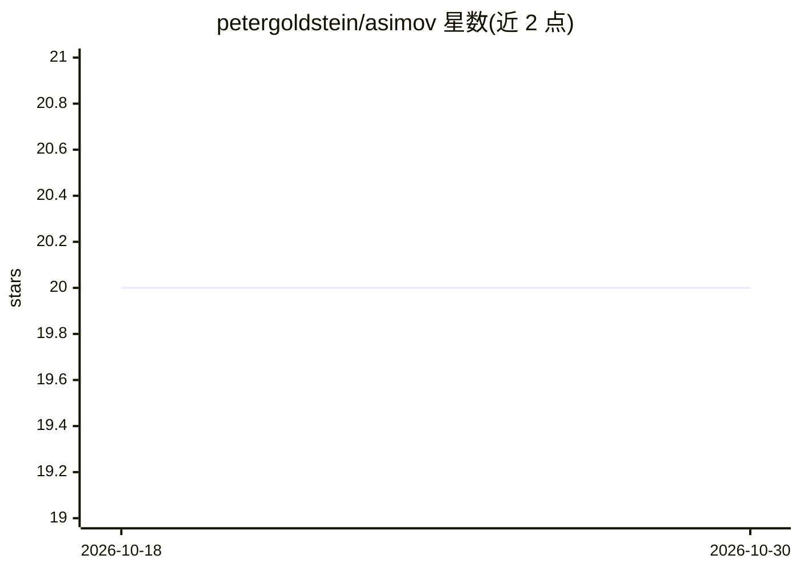

# petergoldstein/asimov

⭐ 20 · Ruby · MIT · 推送 2026-02-22 · [GitHub](https://github.com/petergoldstein/asimov) · 个人维护

**Ruby 的 OpenAI API 客户端库，多配置与网络级控制**

以 Ruby gem 形式提供的 OpenAI API 客户端：支持在单个应用内配置多组 API key 与 organization id，可设置超时与代理以适应复杂网络环境，覆盖 OpenAI API 所有非流式端点（流式支持在考虑中）。面向在 SaaS 应用中集成 OpenAI 能力的 Ruby 开发者，可用于 GPT-3 文本生成、DALL·E 图像生成与 Codex 代码生成。项目由 ruby-openai 分叉而来，采用 MIT 许可。

## 筛选速览

| 维度 | 判定 | 备注 |
|---|---|---|
| AI 角色 | `ai-ecosystem` | LLM/agent 周边工具 |
| 许可风险 | `permissive` | MIT |
| 部署形态 | `None` |  |
| 模型依赖 | — | README 未给出锁定关系 |
| 硬件要求 | — | 无带数字的原话,不猜 |
| 安装摩擦 | `low` | 无编译、无系统依赖或容器化 |
| 成熟度 | — | 结构信号不足 |

## 能力要点

- 单应用内多组 OpenAI 配置（API key 与 organization id）
- 连接级超时与代理配置
- 覆盖 OpenAI API 全部非流式端点

## 适用场景

- Ruby SaaS 应用中调用 GPT-3 生成文本
- 用 DALL·E 生成图像或用 Codex 生成代码
- 多租户场景下按组织切换不同 OpenAI 配置

## 场景标签

 · 领域:LLM 基础设施/API 客户端

## 证据(README 行号)

> L7: Asimov is a gem that enables the use of OpenAI's ML capabilities within SaaS applications. With that in mind it incl
> L11: * Methods for all non-streaming endpoints in the OpenAI API. (Streaming support is under consideration).

## 星数曲线

2026-10-18 20 → 2026-10-30 20（+0）

---
*卡片 v1 · prompt 1.4 · 生成 2026-10-28 · 置信度 high · 依据 README sha `b5058f4cb7df` · [字段定义](../../DATASET.md)*
