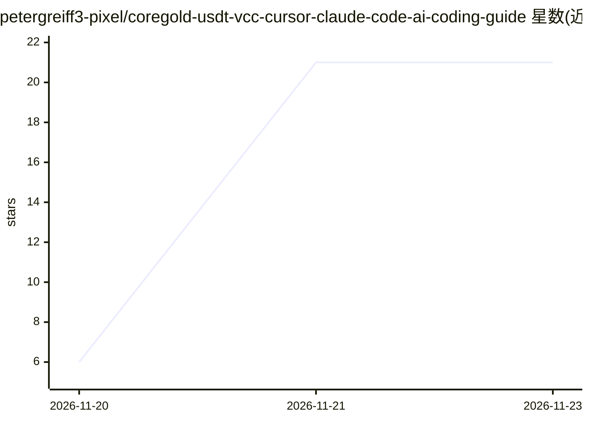

# petergreiff3-pixel/coregold-usdt-vcc-cursor-claude-code-ai-coding-guide

⭐ 21 · 推送 2026-11-19 · [GitHub](https://github.com/petergreiff3-pixel/coregold-usdt-vcc-cursor-claude-code-ai-coding-guide) · [官网](https://app.coregold.io/signup?invite_code=ADvlj9b) · 个人维护

**面向程序员的 AI 编码订阅续费支付指南（CoreGold VCC）**

一份 FinOps 指南，说明如何使用 CoreGold USDT 虚拟卡为 Cursor Pro、GitHub Copilot、Claude Code 等订阅持续续费：解释海外消费卡被 Stripe 风控拦截的原因，给出三步操作——USDT (TRC20) 充值、铸造带固定消费上限的 AI 订阅类虚拟卡、在账单控制台填入卡片信息与北美 AVS 地址。文末含 CoreGold 注册引导及一段哈希字符串。

## 筛选速览

| 维度 | 判定 | 备注 |
|---|---|---|
| AI 角色 | `ai-knowledge` | 知识聚合/清单类 |
| 许可风险 | `none` | — |
| 部署形态 | `None` |  |
| 模型依赖 | — | README 未给出锁定关系 |
| 硬件要求 | — | 无带数字的原话,不猜 |
| 安装摩擦 | `low` | 无编译、无系统依赖或容器化 |
| 成熟度 | — | 结构信号不足 |

## 能力要点

- 解释消费级银行卡被 Stripe 风控拦截的机制
- 三步流程：USDT 充值→铸造 VCC→更新账单设置
- 支持为虚拟卡设置固定月度消费上限

## 适用场景

- 海外开发者续费 Cursor/Claude Code 订阅时被支付拦截
- 为 AI 编码订阅设置独立卡与消费上限

## 场景标签

 · 领域:开发工具/支付指南

## 证据(README 行号)

> L2: A specialized FinOps guide for programmers and indie developers on preventing subscription expirations and billing b
> L5: ## Securing AI Coding Subscriptions: Preventing Cursor & Claude Code Billing Failures with CoreGold VCC

## 星数曲线

2026-11-20 6 → 2026-11-23 21（+15）

---
*卡片 v1 · prompt 1.4 · 生成 2026-11-20 · 置信度 high · 依据 README sha `bcd9973600ba` · [字段定义](../../DATASET.md)*
