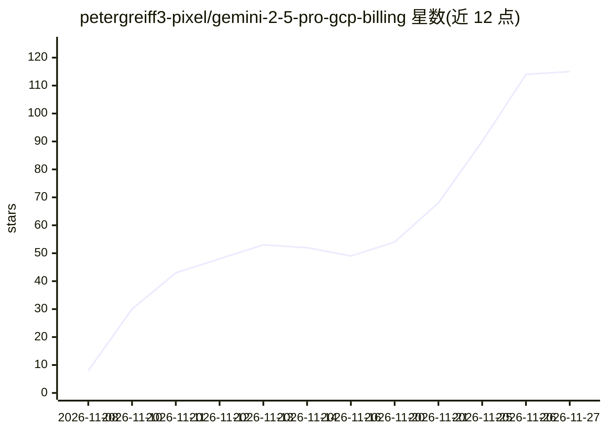

# petergreiff3-pixel/gemini-2-5-pro-gcp-billing

⭐ 115 · 推送 2026-11-06 · [GitHub](https://github.com/petergreiff3-pixel/gemini-2-5-pro-gcp-billing) · [官网](https://app.coregold.io/signup?invite_code=ADvlj9b) · 个人维护 · 中文 README

**推广 CoreGold 虚拟卡以激活 GCP 结算的营销文档，非软件项目**

该仓库 README 为一篇推广文案：叙述在国内双币卡绑定 GCP 结算账号时触发 OR_CCCHS_01 拒付的问题，介绍 GCP 预授权与 AVS 校验机制，随后给出使用 CoreGold 企业商用虚拟卡（USDT 充值、生成商业卡、填写北美 AVS 地址）三步绑定 GCP 的流程，文末附推广链接与一串十六进制码。仓库不含代码、安装方式或可运行产品，不提供任何 AI 功能实现。

## 筛选速览

| 维度 | 判定 | 备注 |
|---|---|---|
| AI 角色 | `ai-ecosystem` | LLM/agent 周边工具 |
| 许可风险 | `none` | — |
| 部署形态 | `None` |  |
| 模型依赖 | — | README 未给出锁定关系 |
| 硬件要求 | — | 无带数字的原话,不猜 |
| 安装摩擦 | `low` | 无编译、无系统依赖或容器化 |
| 成熟度 | — | 结构信号不足 |

## 能力要点

- 解释 GCP 结算账号 OR_CCCHS_01 拒付与 AVS 校验机制
- 给出 CoreGold 虚拟卡三步绑定 GCP 的流程说明
- 仓库无代码与安装方式，内容为虚拟卡服务推广

## 适用场景

- 作为 GCP 绑卡拒付错误的背景阅读材料

## 场景标签

 · 领域:云计算支付/推广

## 证据(README 行号)

> L33: 1. **注入底池**：进入 CoreGold 控制台，充入 USDT，秒转 USD 资金。
> L37: 👉 **立即进入 CoreGold 开卡控制台**

## 星数曲线

2026-11-08 8 → 2026-11-27 115（+107）

---
*卡片 v1 · prompt 1.4 · 生成 2026-11-18 · 置信度 low · 依据 README sha `d89b1c360fce` · [字段定义](../../DATASET.md)*
