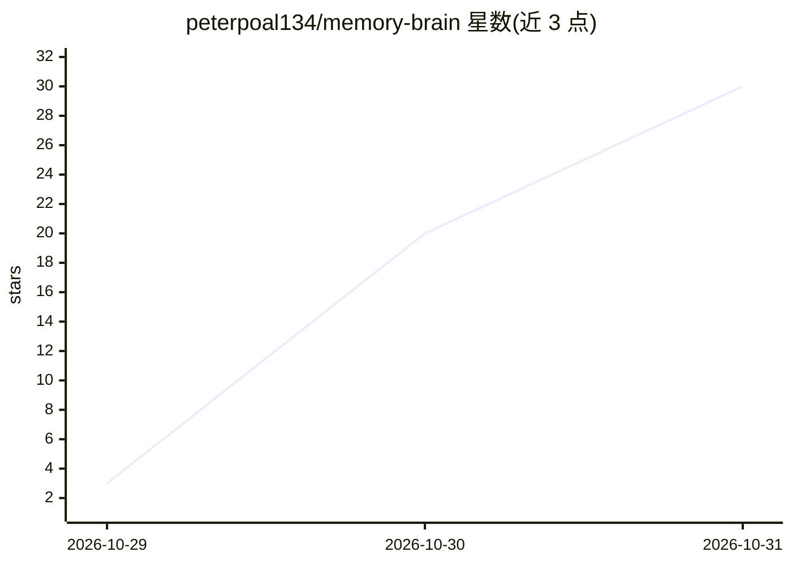

# peterpoal134/memory-brain

⭐ 30 · Python · AGPL-3.0 · 推送 2026-10-30 · [GitHub](https://github.com/peterpoal134/memory-brain) · 个人维护 · 中文 README

**给 AstrBot 的长期记忆与生活层插件套件**

由四个 AstrBot 插件与可选生活层组成的工程整合：五类记忆（事件/事实/反思/技能/道理）分开存储，向量+关键词+实体图谱+重要性+新鲜度五路混合检索，配衰减、归档、相似合并与冲突检测的遗忘治理；情绪层采用 PAD 三维+标签，有上限与半衰期。人格文件只读，增强以带 marker 的注入块追加到 system_prompt，模块默认关闭。生活层以常驻进程执行看书、刷视频等动作，笔记回流记忆。

## 筛选速览

| 维度 | 判定 | 备注 |
|---|---|---|
| AI 角色 | `ai-ecosystem` | LLM/agent 周边工具 |
| 许可风险 | `viral` | AGPL-3.0 |
| 部署形态 | `library` | 以包/库形式分发 |
| 模型依赖 | local-ok | 支持本地模型 |
| 硬件要求 | — | 无带数字的原话,不猜 |
| 安装摩擦 | `low` | 无编译、无系统依赖或容器化 |
| 成熟度 | — | 结构信号不足 |

## 能力要点

- 五类记忆分开存储，五路混合检索
- 衰减/归档/相似合并/冲突检测的遗忘治理
- 人格只读、注入块带 marker、模块默认关
- 带评估脚本与示例评估集（recall@3 100%、MRR 0.938）

## 适用场景

- 给 AstrBot 聊天机器人加长期记忆与检索注入
- 让机器人具备有上限、有半衰期的情绪状态
- 离线场景下自主看书/刷视频并回流记忆笔记

## 场景标签

`Agent 记忆` · 领域:Agent 开发

## 证据(README 行号)

> L30: plugins/                     四个 AstrBot 插件
> L40: 把 `plugins/` 下四个目录放进 `AstrBot/data/plugins/`，重启。

## 星数曲线

2026-10-29 3 → 2026-10-31 30（+27）

---
*卡片 v1 · prompt 1.4 · 生成 2026-10-30 · 置信度 mid · 依据 README sha `8fdbb744f5bb` · [字段定义](../../DATASET.md)*
