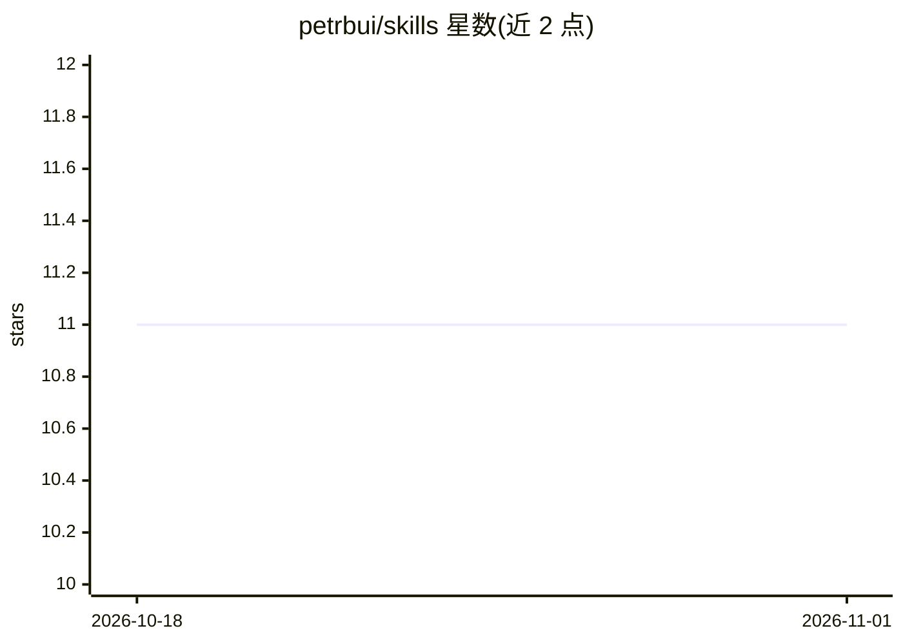

# petrbui/skills

⭐ 11 · MIT · 推送 2026-05-07 · [GitHub](https://github.com/petrbui/skills) · 个人维护

**自适应 AI 老师 agent 技能：定位并补齐知识盲区**

面向开发、产品、QA、设计等学习者的 agent 技能集合，核心技能 GapHunter 以自适应教学模式运行：发现用户薄弱知识点并针对性讲解补齐。以 SKILL 形式提供给 Claude Code、Cursor、Gemini CLI、GitHub Copilot、JetBrains AI 等 agent 使用，通过 npx skills 命令一键安装单个或全部技能，附 README、CHANGELOG 与真实会话记录。MIT 许可。

## 筛选速览

| 维度 | 判定 | 备注 |
|---|---|---|
| AI 角色 | `ai-native` | 本体是模型或模型工具 |
| 许可风险 | `permissive` | MIT |
| 部署形态 | `library` | 以包/库形式分发 |
| 模型依赖 | — | README 未给出锁定关系 |
| 硬件要求 | — | 无带数字的原话,不猜 |
| 安装摩擦 | `low` | 无编译、无系统依赖或容器化 |
| 成熟度 | — | 结构信号不足 |

## 能力要点

- GapHunter 自适应教学技能：定位薄弱点并补齐
- 兼容 Claude Code、Cursor、Gemini CLI、Copilot、JetBrains AI 等多种 agent
- npx skills 命令行按需安装单个或全部技能
- 附带真实会话记录作为示例

## 适用场景

- 让编程 agent 在 Claude Code/Cursor 中当私人老师查漏补缺
- 开发者、PM、QA、设计师利用空闲时间自适应学习
- 为团队统一安装一组教学向 agent 技能

## 场景标签

`教程课程` · 领域:学习与行业

## 证据(README 行号)

> L6: A collection of AI agent skills for Claude Code, Cursor, Gemini CLI, GitHub Copilot, and JetBrains AI.
> L14: The adaptive AI teacher that finds your weak spots and fills them — for developers, PMs, QA engineers, designers, a

## 星数曲线

2026-10-18 11 → 2026-11-01 11（+0）

---
*卡片 v1 · prompt 1.4 · 生成 2026-11-01 · 置信度 mid · 依据 README sha `eec1640ffa86` · [字段定义](../../DATASET.md)*
