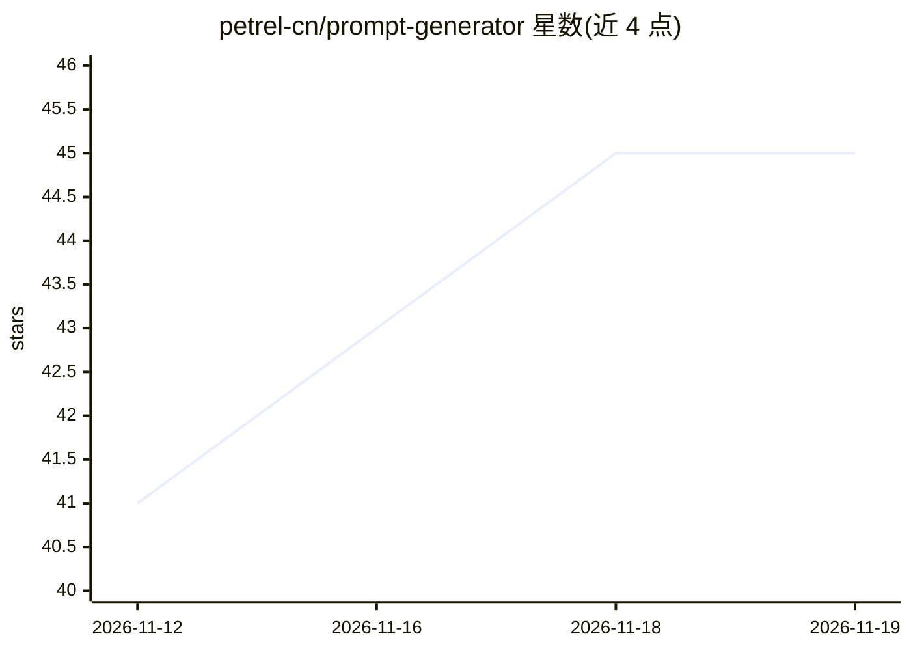

# petrel-cn/prompt-generator

⭐ 45 · C# · MIT · 推送 2026-10-03 · [GitHub](https://github.com/petrel-cn/prompt-generator) · 个人维护 · 中文 README

**中文/图片转英文绘图提示词的 Windows 单文件桌面工具**

基于 .NET Framework 4.8 与 C# 5 编写的 WinForms 单机工具：输入中文文本描述或上传单张图片（JPG/PNG/WebP/BMP，≤32 MiB），调用 DeepSeek API 生成英文 text-to-image 提示词，支持额外指令与 Pony Mode 标签、图片反推、提示词保存与查看、思考模式配置。API Key 经 DPAPI 密文存储于 %APPDATA%，系统提示词在 prompt.txt 中可自行修改。仅支持 DeepSeek 一个服务商，需 Windows 10/11 与自有 API Key。

## 筛选速览

| 维度 | 判定 | 备注 |
|---|---|---|
| AI 角色 | `ai-native` | 本体是模型或模型工具 |
| 许可风险 | `permissive` | MIT |
| 部署形态 | `desktop` | 安装包/桌面程序 |
| 模型依赖 | locked-api |  |
| 硬件要求 | — | 无带数字的原话,不猜 |
| 安装摩擦 | `low` | 无编译、无系统依赖或容器化 |
| 成熟度 | — | 结构信号不足 |

## 能力要点

- 文本/图片（反推）转英文绘图提示词，调用 DeepSeek API
- 零第三方依赖：系统自带 csc.exe 编译，单文件 exe 双击即用
- 系统提示词 prompt.txt 可自行修改，改完即生效
- API Key 以 DPAPI 密文存储，不落明文

## 适用场景

- 把中文描述翻成 Stable Diffusion 等 English 绘图提示词
- 上传图片反推英文提示词并用额外指令限定描述范围
- 生成 Pony 格式正面提示词

## 场景标签

`提示工程` · 领域:Agent 开发

## 证据(README 行号)

> L3: 把文本描述或上传的图片，翻译 / 反推为英文绘图提示词（text-to-image prompt）的单机 Windows 桌面工具。并且可以根据用户的额外指令，对提示词进行相应修改。
> L14: - **独立 API Key**：仅支持 DeepSeek，不与其它软件共享凭据，密文存储

## 星数曲线

2026-11-12 41 → 2026-11-19 45（+4）

---
*卡片 v1 · prompt 1.4 · 生成 2026-11-18 · 置信度 high · 依据 README sha `7bee6361c26e` · [字段定义](../../DATASET.md)*
