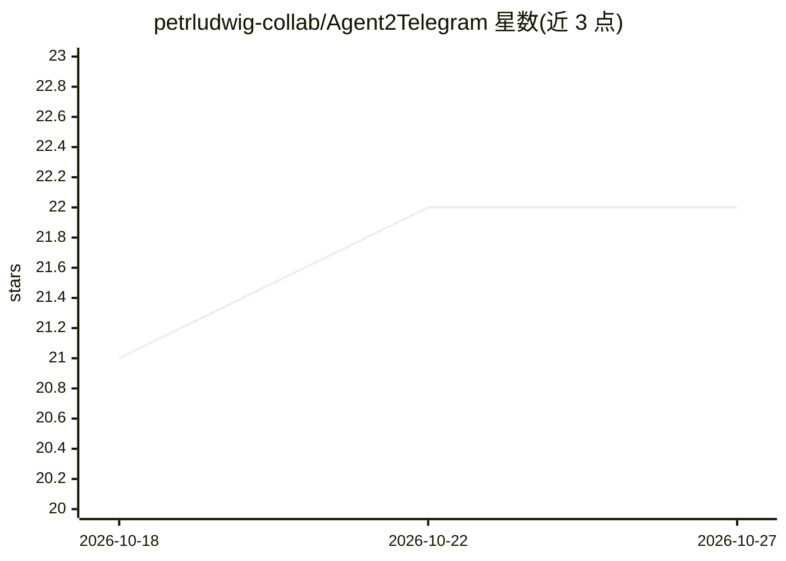

# petrludwig-collab/Agent2Telegram

⭐ 22 · Python · MIT · 推送 2026-10-23 · [GitHub](https://github.com/petrludwig-collab/Agent2Telegram) · 组织维护

**把编码代理（Claude Code/Codex）接入 Telegram 的本地桥接工具**

仅依赖 Python 标准库的桥接程序：在用户自己的机器上长轮询 Telegram 消息，转发给所选的编码代理 CLI（Claude Code 或 Codex），并把回复送回 Telegram；无需公网 IP、webhook 或云端。支持发送文本、图片、文件和语音消息（语音经用户自备的 ElevenLabs key 用 Scribe 转写）。安全上仅允许白名单 Telegram 用户驱动代理。通过 3 步向导配置提供者、tmux 会话与 bot token，多代理可各配独立 bot。需 Python 3.10+ 及已登录的代理 CLI。

## 筛选速览

| 维度 | 判定 | 备注 |
|---|---|---|
| AI 角色 | `ai-ecosystem` | LLM/agent 周边工具 |
| 许可风险 | `permissive` | MIT |
| 部署形态 | `self-host` | docker 或自建部署 |
| 模型依赖 | — | README 未给出锁定关系 |
| 硬件要求 | — | 无带数字的原话,不猜 |
| 安装摩擦 | `low` | 无编译、无系统依赖或容器化 |
| 成熟度 | — | 结构信号不足 |

## 能力要点

- 核心仅用 Python 标准库，无需 pip install
- 长轮询方式运行，无需公网 IP、端口转发或域名
- 仅白名单 Telegram 用户可驱动代理
- 支持文本/图片/文件/语音（ElevenLabs Scribe 转写，默认关闭）

## 适用场景

- 在手机 Telegram 上远程使用本机的编码代理
- 出差的开发者在移动端继续操作 Claude Code/Codex 会话
- 通过 notify 命令在 cron/构建脚本结束时推送通知

## 场景标签

`编码 Agent` · 领域:编码与开发

## 证据(README 行号)

> L10: Agent2Telegram is a tiny, dependency‑free bridge. It long‑polls Telegram for messages from
> L11: **you** (and only you), hands each one to the agent CLI of your choice, and sends the reply
> L173: The bridge shells out to these tools, so whatever they can do in your terminal, they can do

## 星数曲线

2026-10-18 21 → 2026-10-27 22（+1）

---
*卡片 v1 · prompt 1.4 · 生成 2026-10-27 · 置信度 mid · 依据 README sha `ccbdbbb4e815` · [字段定义](../../DATASET.md)*
