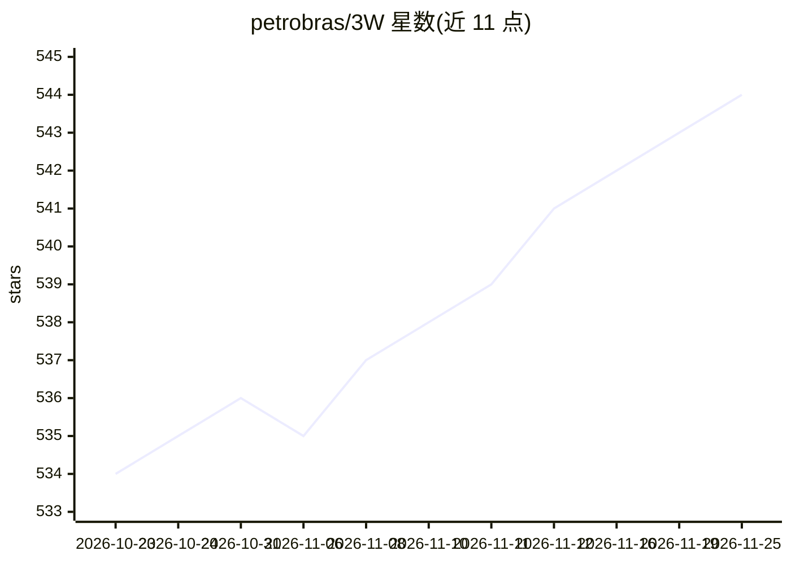

# petrobras/3W

⭐ 544 · Jupyter Notebook · Apache-2.0 · 推送 2026-11-16 · [GitHub](https://github.com/petrobras/3W) · [官网](https://threewtoolkit.readthedocs.io) · 组织维护

**海上油井不良事件检测的数据集与机器学习实验工具包**

Petrobras 在 GitHub 发布的首个仓库，支持 3W 项目：面向海上油气井钻完井与生产阶段不良事件的检测与分类问题。由两部分组成：3W Dataset（来自 3 种来源、以 Parquet 文件组织的真实事件数据，持续补充实例）和 3W Toolkit（Python 3 包，提供数据集概览生成、ML 方法实验与对比分析、算法开发流程标准化）。代码采用 Apache 2.0，数据文件采用 CC BY 4.0，安装推荐 uv 虚拟环境。

## 筛选速览

| 维度 | 判定 | 备注 |
|---|---|---|
| AI 角色 | `ai-knowledge` | 知识聚合/清单类 |
| 许可风险 | `permissive` | Apache-2.0 |
| 部署形态 | `library` | 以包/库形式分发 |
| 模型依赖 | — | README 未给出锁定关系 |
| 硬件要求 | — | 无带数字的原话,不猜 |
| 安装摩擦 | `low` | 无编译、无系统依赖或容器化 |
| 成熟度 | `idea` | |

## 能力要点

- 首个公开的真实油井稀有不良事件基准数据集，含标注实例并持续演进
- 3W Toolkit 支持 ML 方法的实验与标准化对比分析
- 双许可：代码 Apache 2.0、数据 CC BY 4.0
- 提供数据集概览 Jupyter Notebook 与基准贡献机制

## 适用场景

- 油井不良事件检测与分类算法的开发与基准评测
- 多元时间序列异常检测方法的对比实验
- 石油行业数据科学研究与教学

## 场景标签

`模型评测` · 领域:评测与运维

## 证据(README 行号)

> L14: This is the first repository published by Petrobras on GitHub. It supports the 3W Project, which aims to promote ex
> L98: The 3W Dataset consists of multiple Parquet files saved in subdirectories of the dataset directory and structured a
> L106: The 3W Toolkit is a software package written in Python 3 that contains resources that make the following easier:

## 星数曲线

2026-10-23 534 → 2026-11-25 544（+10）

---
*卡片 v1 · prompt 1.4 · 生成 2026-11-25 · 置信度 high · 依据 README sha `aca8b633decd` · [字段定义](../../DATASET.md)*
