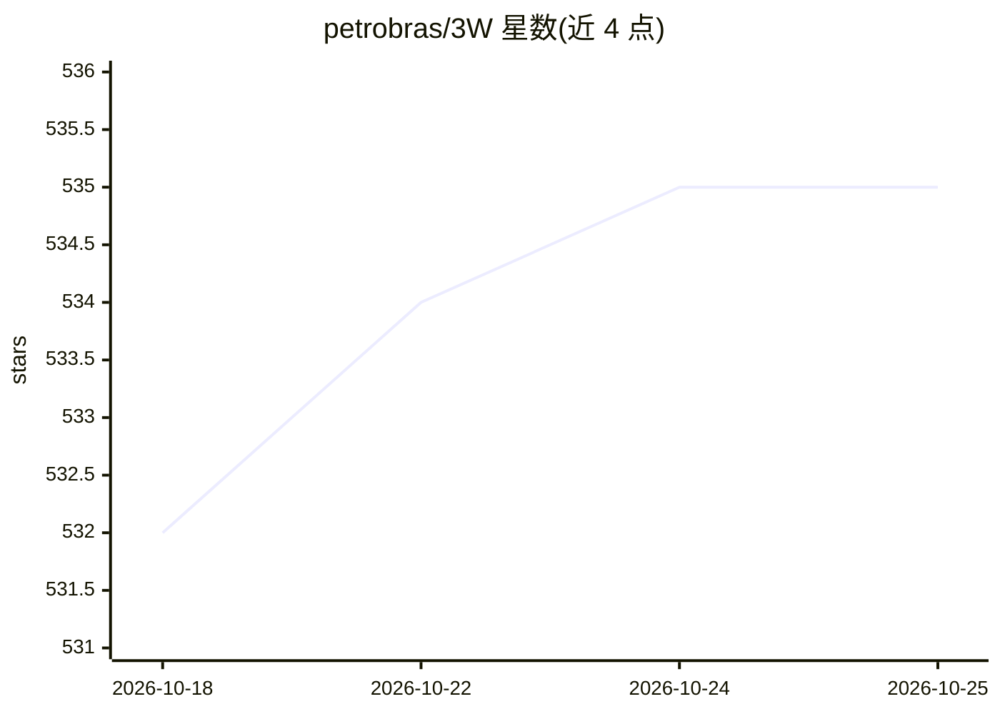

# petrobras/3W

⭐ 535 · Jupyter Notebook · Apache-2.0 · 推送 2026-10-22 · [GitHub](https://github.com/petrobras/3W) · [官网](https://threewtoolkit.readthedocs.io) · 组织维护

**海上油井异常事件公开数据集与配套机器学习实验工具包**

Petrobras 发布的开源项目，含两部分：3W Dataset 是首个包含油井真实罕见不良事件的多变量时间序列公开数据集（Parquet 文件，可作机器学习基准），覆盖钻完井与生产阶段；3W Toolkit 是 Python 3 软件包，支持数据集概览生成、不良事件检测与分类算法的实验对比分析，并标准化开发流程关键点。面向个人研究者、科研机构、初创公司、石油运营商等社区，代码 Apache 2.0、数据 CC BY 4.0，数据集与工具包独立语义化版本管理。

## 筛选速览

| 维度 | 判定 | 备注 |
|---|---|---|
| AI 角色 | `ai-knowledge` | 知识聚合/清单类 |
| 许可风险 | `permissive` | Apache-2.0 |
| 部署形态 | `library` | 以包/库形式分发 |
| 模型依赖 | — | README 未给出锁定关系 |
| 硬件要求 | — | 无带数字的原话,不猜 |
| 安装摩擦 | `low` | 无编译、无系统依赖或容器化 |
| 成熟度 | — | 结构信号不足 |

## 能力要点

- 首个含油井真实罕见不良事件的公开基准数据集（Parquet 格式）
- Python 3 工具包支持 ML 方法的实验与对比分析
- 提供 Jupyter Notebook 形式的数据集概览与使用示例
- 数据集与工具包采用独立的语义化版本管理

## 适用场景

- 为油井不良事件检测/分类研究提供基准数据集
- 在统一流程下对比不同机器学习检测算法
- 为海上油井监测系统的算法开发提供实验环境

## 场景标签

`科研工具` · 领域:学习与行业

## 证据(README 行号)

> L14: This is the first repository published by Petrobras on GitHub. It supports the 3W Project, which aims to promote ex
> L87: To the best of its authors' knowledge, this is the first realistic and public dataset with rare undesirable real ev

## 星数曲线

2026-10-18 532 → 2026-10-25 535（+3）

---
*卡片 v1 · prompt 1.4 · 生成 2026-10-21 · 置信度 high · 依据 README sha `0ca87ce9bb96` · [字段定义](../../DATASET.md)*
