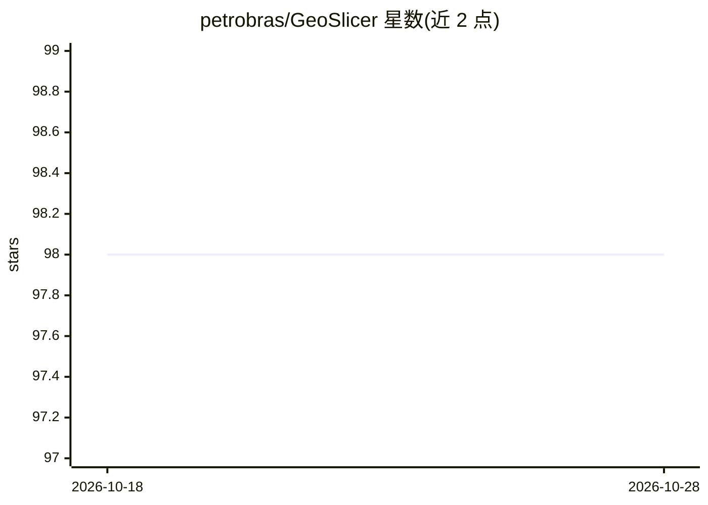

# petrobras/GeoSlicer

⭐ 98 · Python · Apache-2.0 · 推送 2026-10-06 · [GitHub](https://github.com/petrobras/GeoSlicer) · [官网](https://www.ltrace.com.br/geoslicer) · 组织维护

**面向地质科学的数字岩石图像分析与可视化平台**

基于 3D Slicer 构建的数字岩石可视化与图像处理软件平台，供地质学家、工程师和研究人员分析薄片、CT 与 micro-CT 等多种成像模态的 2D/3D 数据。功能包括图像滤波与分割、孔隙网络提取与分析、岩石物理性质计算（孔隙度、渗透率）以及 3D 可视化与动画；主题标签与引用文献显示其包含 AI 与机器学习工具及 HPC 能力。以便携压缩包形式分发，无需安装器，支持通过自定义模块扩展。限制：Windows 10 及更早版本未获官方支持，建议 NVIDIA 驱动不超过 576.28。

## 筛选速览

| 维度 | 判定 | 备注 |
|---|---|---|
| AI 角色 | `ai-enhanced` | 去掉 AI 部分产品仍成立 |
| 许可风险 | `permissive` | Apache-2.0 |
| 部署形态 | `desktop` | 安装包/桌面程序 |
| 模型依赖 | — | README 未给出锁定关系 |
| 硬件要求 | — | 无带数字的原话,不猜 |
| 安装摩擦 | `medium` | 含编译或系统依赖之一 |
| 成熟度 | — | 结构信号不足 |

## 能力要点

- 支持薄片、CT、micro-CT 等多模态 2D/3D 图像处理
- 孔隙网络提取与孔隙度、渗透率等岩石物理计算
- 基于 3D Slicer，支持自定义模块扩展
- 便携应用，解压即用，无需安装器

## 适用场景

- 分析岩石 CT/micro-CT 图像并计算孔渗性质
- 提取和可视化孔隙网络结构
- 在现有平台上扩展自己的地质图像处理模块

## 场景标签

`图像视频处理` · 领域:感知与多模态

## 证据(README 行号)

> L12: GeoSlicer is a software platform for digital rock visualization and image processing. It's designed for geoscientis
> L21: GeoSlicer is built on top of 3D Slicer medical imaging platform and can be extended with custom modules to meet you

## 星数曲线

2026-10-18 98 → 2026-10-28 98（+0）

---
*卡片 v1 · prompt 1.4 · 生成 2026-10-23 · 置信度 high · 依据 README sha `87518478058d` · [字段定义](../../DATASET.md)*
