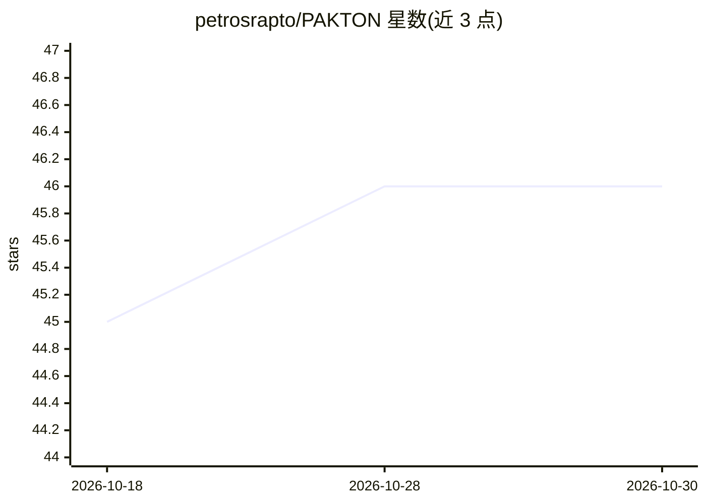

# petrosrapto/PAKTON

⭐ 46 · Jupyter Notebook · Apache-2.0 · 推送 2025-12-08 · [GitHub](https://github.com/petrosrapto/PAKTON) · [官网](https://pakton.site/) · 组织维护

**多智能体框架：对长法律合同做问答与自动审查**

面向合同审查的开源端到端框架：由多个分工的 LLM agent 协作，结合检索增强生成（RAG）对长法律协议进行问答并生成综合报告，设计上支持本地化部署以处理私密合同。论文发表于 EMNLP 2025 主会并作口头报告。README 声明在线版与仓库代码暂缺部分组件，将后续补充；仓库内未见安装运行命令，需查阅 LICENSE 文件确认许可条款。提供 pakton.site 在线版本与评估结果页面。

## 筛选速览

| 维度 | 判定 | 备注 |
|---|---|---|
| AI 角色 | `ai-native` | 本体是模型或模型工具 |
| 许可风险 | `permissive` | Apache-2.0 |
| 部署形态 | `None` |  |
| 模型依赖 | — | README 未给出锁定关系 |
| 硬件要求 | — | 无带数字的原话,不猜 |
| 安装摩擦 | `low` | 无编译、无系统依赖或容器化 |
| 成熟度 | `idea` | |

## 能力要点

- 多智能体协作 + RAG 的合同分析流水线，输出可解释报告
- 在 ContractNLI 与 LegalBenchRAG 上做了定量评估，并含人工评估与 GEVAL
- 开源并声明支持本地部署（on-premise）
- 提供在线部署版本 pakton.site

## 适用场景

- 上传合同并提出问题，获得带解释的综合审查报告
- 在私密数据不能外传的前提下本地运行合同问答
- 复现论文中的法律问答评估实验

## 场景标签

`多智能体` `RAG` `文档问答` · 领域:Agent 开发

## 证据(README 行号)

> L19: **PAKTON** solves these problems with an open-source, end-to-end framework for automated contract review. It uses a
> L41: PAKTON employs a sophisticated multi-agent architecture that orchestrates specialized AI agents to handle different
> L25: **PAKTON** was published at the **Main Conference of EMNLP 2025** and presented orally by **Petros Raptopoulos**.

## 星数曲线

2026-10-18 45 → 2026-10-30 46（+1）

---
*卡片 v1 · prompt 1.4 · 生成 2026-10-25 · 置信度 high · 依据 README sha `ee2090f3842e` · [字段定义](../../DATASET.md)*
