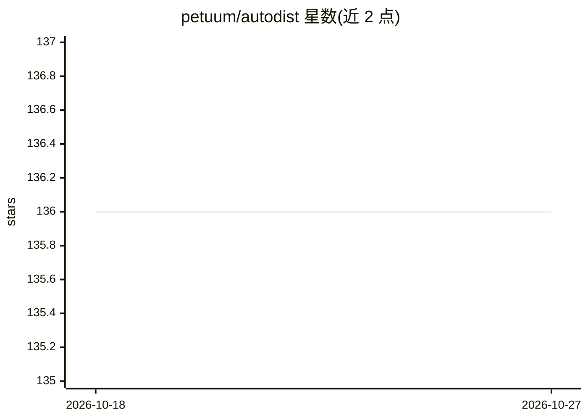

# petuum/autodist

⭐ 136 · Python · Apache-2.0 · 推送 2026-02-05 · [GitHub](https://github.com/petuum/autodist) · [官网](https://petuum.github.io/autodist) · 组织维护

**TensorFlow 分布式深度学习训练引擎：多 GPU 训练加速**

面向 TensorFlow 用户的分布式深度学习训练引擎：通过编译过程表达模型并行化（同步、切分、放置等维度），生成适配模型属性与集群配置的分布策略，以少量代码改动将单机模型训练扩展到多 GPU。提供可组合后端以混合不同分布式 ML 架构，通过 pip 安装并以 Python API 使用。由 petuum 组织维护，借鉴 Horovod、Parallax、tf.distribute 等项目。

## 筛选速览

| 维度 | 判定 | 备注 |
|---|---|---|
| AI 角色 | `ai-ecosystem` | LLM/agent 周边工具 |
| 许可风险 | `permissive` | Apache-2.0 |
| 部署形态 | `library` | 以包/库形式分发 |
| 模型依赖 | — | README 未给出锁定关系 |
| 硬件要求 | — | 无带数字的原话,不猜 |
| 安装摩擦 | `low` | 无编译、无系统依赖或容器化 |
| 成熟度 | — | 结构信号不足 |

## 能力要点

- 以标准化编译过程表达模型并行化（同步/切分/放置）
- 模型与资源感知的策略生成，适配模型属性与集群配置
- 可组合后端支持混合不同分布式 ML 架构
- 少量代码改动即可将现有 TensorFlow 代码分布式化

## 适用场景

- 把手头 TensorFlow 训练代码扩展到多 GPU 集群
- 在分布式训练中切换或组合不同并行化策略
- 按集群规格自动生成分布策略而非手工配置

## 场景标签

`模型训练` · 领域:训练与推理

## 证据(README 行号)

> L8: **AutoDist** is a distributed deep learning training engine for TensorFlow. AutoDist provides a user-friendly interf
> L15: - **Composable architecture**: AutoDist contains a flexible backend that can express various different ML paralleli

## 星数曲线

2026-10-18 136 → 2026-10-27 136（+0）

---
*卡片 v1 · prompt 1.4 · 生成 2026-10-22 · 置信度 high · 依据 README sha `650b438bafe5` · [字段定义](../../DATASET.md)*
