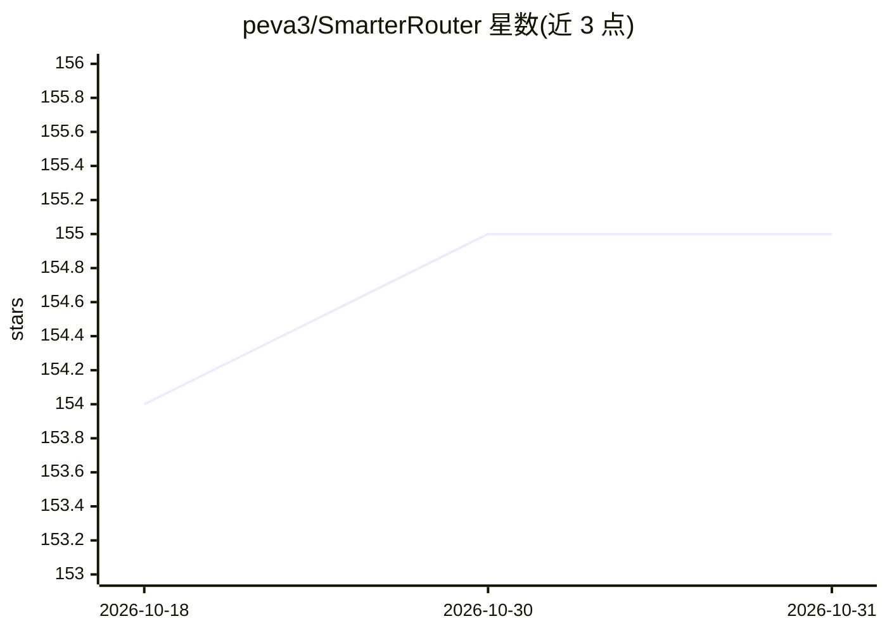

# peva3/SmarterRouter

⭐ 155 · Python · MIT · 推送 2026-05-10 · [GitHub](https://github.com/peva3/SmarterRouter) · 个人维护

**多后端 LLM 网关与 VRAM 感知路由器，自动为每条查询选模型**

位于应用与 LLM 后端（Ollama、llama.cpp、OpenAI 及外部云厂商）之间的智能路由网关：自动发现后端模型、在用户硬件上做性能画像、按提示的类别与复杂度选模型，并提供 VRAM 监控与模型卸载、失败自动重试、相同提示缓存、用户反馈持续学习。兼容 OpenAI 客户端，可接入 OpenWebUI；提供 Docker 一键部署与 CLI 交互式配置向导。面向本地 AI 实验环境，全部配置经 .env 文件完成。

## 筛选速览

| 维度 | 判定 | 备注 |
|---|---|---|
| AI 角色 | `ai-ecosystem` | LLM/agent 周边工具 |
| 许可风险 | `permissive` | MIT |
| 部署形态 | `None` |  |
| 模型依赖 | local-ok | 支持本地模型 |
| 硬件要求 | — | 无带数字的原话,不猜 |
| 安装摩擦 | `low` | 无编译、无系统依赖或容器化 |
| 成熟度 | — | 结构信号不足 |

## 能力要点

- 自动模型发现与按硬件性能画像，按提示智能选模型
- VRAM 监控（NVIDIA/AMD/Intel/Apple Silicon）与自动卸载
- 失败自动回退与相同提示缓存
- OpenAI 兼容接口，支持 Ollama/llama.cpp/OpenAI 多后端及外部云厂商前缀路由

## 适用场景

- 本地跑多个模型，不想每次手动挑选调用哪个
- 显存有限时自动卸载/切换模型避免溢出
- 在 OpenWebUI 等客户端后统一接入本地与云端模型

## 场景标签

`模型网关` · 领域:Agent 开发

## 证据(README 行号)

> L3: **Intelligent, multi-backend AI router** that sits between your application and various LLM providers. It profiles y
> L15: |**Multi-Backend Support**|✅ Ollama + llama.cpp + OpenAI|❌ OpenAI-only|❌ Claude-only|✅ 100+ providers|❌ URL proxy|

## 星数曲线

2026-10-18 154 → 2026-10-31 155（+1）

---
*卡片 v1 · prompt 1.4 · 生成 2026-10-22 · 置信度 high · 依据 README sha `a40bba78a929` · [字段定义](../../DATASET.md)*
