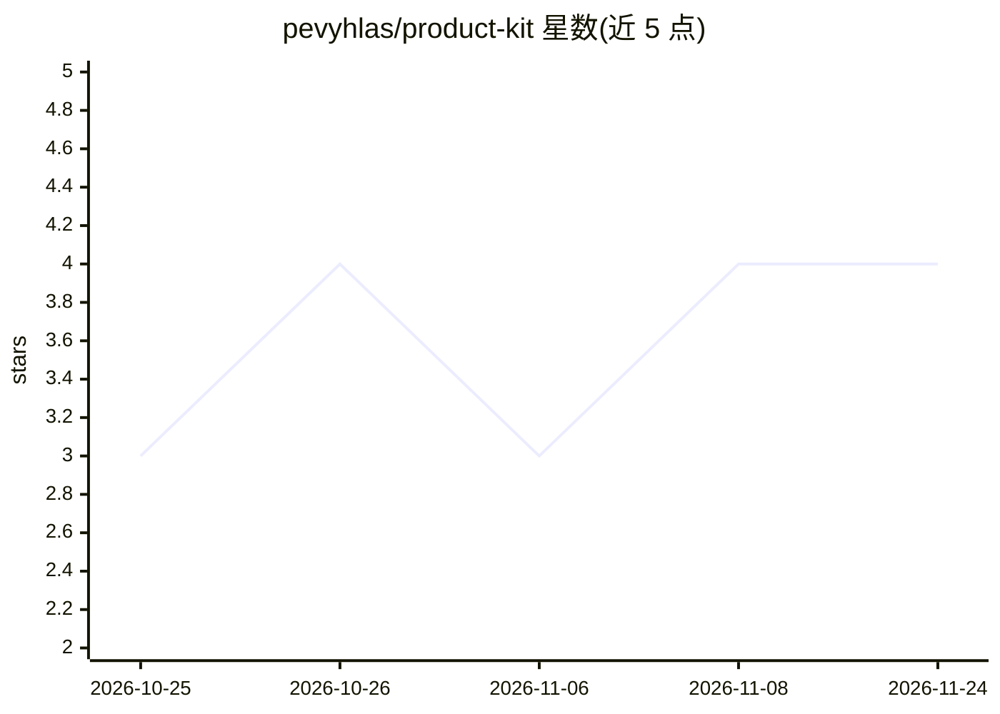

# pevyhlas/product-kit

⭐ 4 · Shell · MIT · 推送 2026-11-24 · [GitHub](https://github.com/pevyhlas/product-kit) · 个人维护

**给开发团队的单一产品规格：让编码 Agent 随代码同步维护**

Product-Kit 是一个以 git 子模块形式安装到仓库中的规格管理工具包：将产品的问题定义、目标用户、用户旅程、架构与假设收敛为一份简短的 Markdown 规格，编码 Agent 在每次变更前读取该规格，并在同一个 pull request 中同步更新它。安装脚本可为 Claude Code、OpenCode、Codex 等 Agent 生成斜杠命令或 AGENTS.md 段落，提供 /prdkit 系列命令、问答收件箱、CI 校验脚本与分级审查规则。要求 Git 与 Bash；标注为实验状态，单一维护者。

## 筛选速览

| 维度 | 判定 | 备注 |
|---|---|---|
| AI 角色 | `ai-ecosystem` | LLM/agent 周边工具 |
| 许可风险 | `permissive` | MIT |
| 部署形态 | `None` |  |
| 模型依赖 | — | README 未给出锁定关系 |
| 硬件要求 | — | 无带数字的原话,不猜 |
| 安装摩擦 | `low` | 无编译、无系统依赖或容器化 |
| 成熟度 | `idea` | |

## 能力要点

- 规格与代码在同一 PR 中变更，变更留下一行日志
- Agent 提问时附选项、建议与默认值，意图由人持有
- 安装脚本适配 claude/opencode/codex 等多种 Agent harness
- CI 门禁校验规格完整性与审查回执，按 T0–T3 分级

## 适用场景

- 让编码 Agent 在没有上下文丢失的情况下理解产品方向
- 把散落在文档和聊天中的产品定义收敛进仓库内一份规格
- 为每个变更配置与风险相称的审查层级

## 场景标签

 · 领域:软件开发流程/产品规格管理

## 证据(README 行号)

> L3: ### One short, current spec of what your product must be. Your coding agent changes it together with the code.
> L81: |**Agents**|⚠️ Installs for Claude Code, OpenCode, Codex and other `AGENTS.md` readers; real-agent testing is still

## 星数曲线

2026-10-25 3 → 2026-11-24 4（+1）

---
*卡片 v1 · prompt 1.4 · 生成 2026-11-21 · 置信度 high · 依据 README sha `015f12316618` · [字段定义](../../DATASET.md)*
