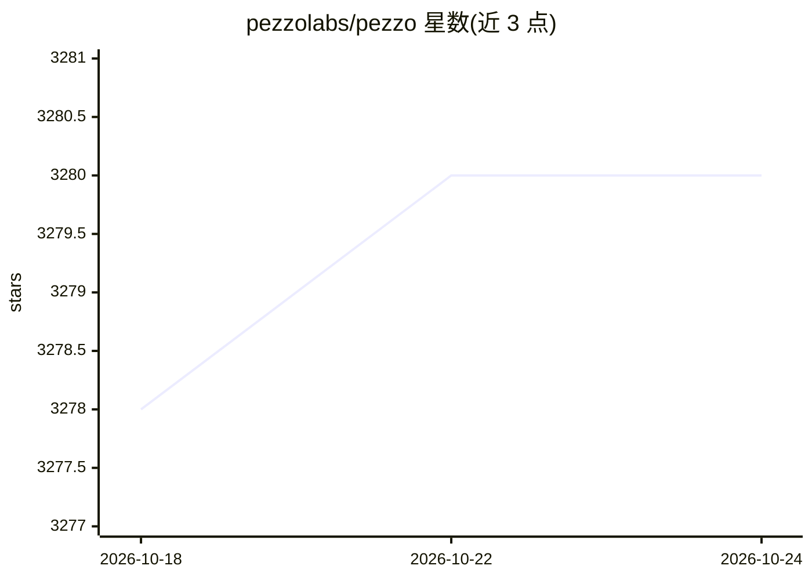

# pezzolabs/pezzo

⭐ 3,278 · TypeScript · Apache-2.0 · 推送 2026-08-21 · [GitHub](https://github.com/pezzolabs/pezzo) · [官网](https://pezzo.ai) · 组织维护

**开源 LLMOps 平台：提示词管理、可观测性与协作**

面向开发者的云原生开源 LLMOps 平台，提供提示词管理、版本管理与即时交付、可观测性监控、问题排查、缓存与成本/延迟优化等功能，供团队在一个地方协作管理 AI 应用。支持 Node.js、Python 与 LangChain 客户端。后端依赖 PostgreSQL、ClickHouse、Redis 与 Supertokens，可通过 Docker Compose 运行完整技术栈，也可在开发模式下从源码运行。以 Apache 2.0 许可发布。

## 筛选速览

| 维度 | 判定 | 备注 |
|---|---|---|
| AI 角色 | `ai-ecosystem` | LLM/agent 周边工具 |
| 许可风险 | `permissive` | Apache-2.0 |
| 部署形态 | `self-host` | docker 或自建部署 |
| 模型依赖 | — | README 未给出锁定关系 |
| 硬件要求 | — | 无带数字的原话,不猜 |
| 安装摩擦 | `low` | 无编译、无系统依赖或容器化 |
| 成熟度 | — | 结构信号不足 |

## 能力要点

- 提示词管理、可观测性、缓存能力覆盖 Node.js / Python / LangChain 客户端
- 云原生架构，依赖 PostgreSQL、ClickHouse、Redis、Supertokens 等开源组件
- 支持 Docker Compose 一键运行完整技术栈
- 提供服务端与 Pezzo Console 的本地开发运行流程

## 适用场景

- 团队集中管理 LLM 提示词并做版本控制
- 监控与排查 LLM 应用的调用与成本
- 通过缓存降低调用成本与延迟

## 场景标签

`提示工程` `LLM 可观测性` · 领域:Agent 开发

## 证据(README 行号)

> L9:  Pezzo is a fully cloud-native and open-source LLMOps platform. Seamlessly observe and monitor your AI operations, t
> L45:  Feature

## 星数曲线

2026-10-18 3,278 → 2026-10-24 3,280（+2）

---
*卡片 v1 · prompt 1.4 · 生成 2026-10-20 · 置信度 high · 依据 README sha `ab9b221f9210` · [字段定义](../../DATASET.md)*
