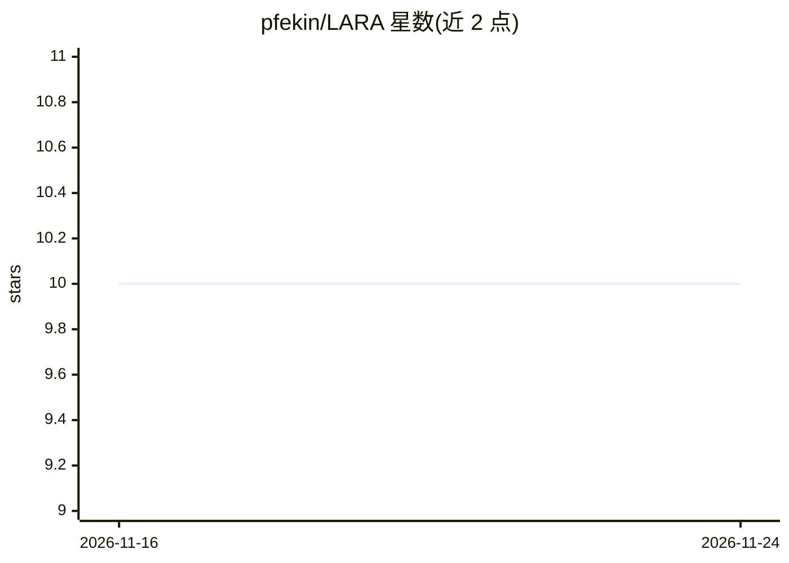

# pfekin/LARA

⭐ 10 · Jupyter Notebook · NOASSERTION · 推送 2026-09-14 · [GitHub](https://github.com/pfekin/LARA) · 个人维护

**给冻结 LLM 做轻量残差流适配训练的 Python 库**

LARA 是针对冻结语言模型的后训练适配库：在残差流上读取隐状态并叠加低秩修正，生成几 MB 大小的 behavior 工件，不改基础模型权重。多个 behavior 可同时加载、按 token 路由组合（MoBs），推理时可经 gamma 调节强度。兼容 HF Trainer 与 TRL 的 DPO/GRPO 训练器，行为可在不同基模型与量化版本间迁移。需要 Python 3.9+、torch 2.0+，示例可在一块 GPU 上端到端运行。

## 筛选速览

| 维度 | 判定 | 备注 |
|---|---|---|
| AI 角色 | `ai-ecosystem` | LLM/agent 周边工具 |
| 许可风险 | `none` | NOASSERTION |
| 部署形态 | `library` | 以包/库形式分发 |
| 模型依赖 | — | README 未给出锁定关系 |
| 硬件要求 | — | 无带数字的原话,不猜 |
| 安装摩擦 | `low` | 无编译、无系统依赖或容器化 |
| 成熟度 | — | 结构信号不足 |

## 能力要点

- 残差流低秩修正，冻结基模型权重不改写
- MoB 行为库：多 behavior 按 token 软/硬路由、pin 覆盖与 gamma 缩放
- 兼容 HF Trainer 与 TRL 的 DPOTrainer/GRPOTrainer
- behavior 工件为几 MB 文件，可跨基模型与量化迁移

## 适用场景

- 在共享基模型上增量添加领域行为而不重训模型
- 训练后按需组合写作风格、领域推理等多种行为
- 端侧小模型用小体积适配件替代长系统提示
- 构建可独立分发与加载的专项能力库

## 场景标签

`微调` `强化学习` · 领域:训练与推理

## 证据(README 行号)

> L19: LARA adapts a frozen language model without modifying its weights, producing a small **behavior** artifact (a few M
> L37: The larger system built around LARA is **Mixture of Behaviors (MoBs)**. A MoB is a collection of independently trai
> L100: `layers=6` spreads six adapters evenly over the depth. Pass a list for exact control. LARA works with HF `Trainer`

## 星数曲线

2026-11-16 10 → 2026-11-24 10（+0）

---
*卡片 v1 · prompt 1.4 · 生成 2026-11-19 · 置信度 high · 依据 README sha `476d196cb3a4` · [字段定义](../../DATASET.md)*
