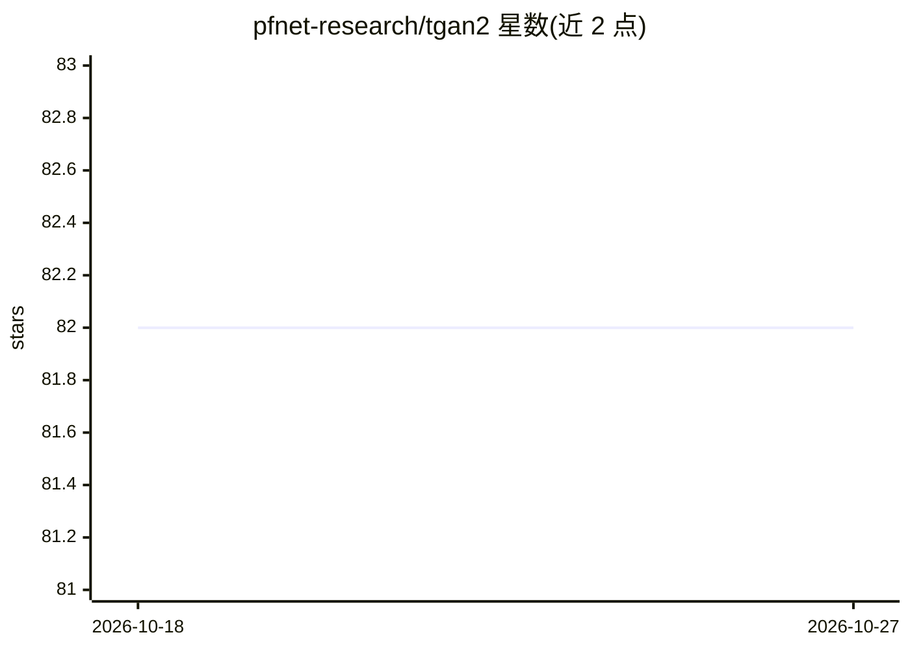

# pfnet-research/tgan2

⭐ 82 · Python · MIT · 推送 2026-02-05 · [GitHub](https://github.com/pfnet-research/tgan2) · [官网](https://arxiv.org/abs/1811.09245) · 组织维护

**论文官方实现：高分辨率时序 GAN 的无监督视频生成**

TGANv2 的官方实现仓库，对应论文《Train Sparsely, Generate Densely: Memory-efficient Unsupervised Training of High-resolution Temporal GAN》。提供在 UCF101 与 FaceForensics 数据集上训练 TGANv2 的脚本、数据预处理流程、预训练 C3D 权重下载以及 Inception score 与 FID 评测脚本。环境基于 Docker 与 nvidia-docker，测试环境为多卡 V100/P100 GPU，训练命令通过 mpiexec 多进程运行。供复现论文实验的科研人员使用。

## 筛选速览

| 维度 | 判定 | 备注 |
|---|---|---|
| AI 角色 | `ai-native` | 本体是模型或模型工具 |
| 许可风险 | `permissive` | MIT |
| 部署形态 | `self-host` | docker 或自建部署 |
| 模型依赖 | — | README 未给出锁定关系 |
| 硬件要求 | — | 无带数字的原话,不猜 |
| 安装摩擦 | `low` | 无编译、无系统依赖或容器化 |
| 成熟度 | — | 结构信号不足 |

## 能力要点

- 提供 UCF101 与 FaceForensics 的数据下载与预处理脚本
- 基于 Docker/nvidia-docker 的训练与评测流程
- Inception score 与 FID 评测脚本及论文结果数值
- 内存高效的高分辨率视频生成训练实现

## 适用场景

- 复现论文中的 TGANv2 训练与评测实验
- 在 UCF101/FaceForensics 上训练视频生成模型
- 对比时序 GAN 架构的生成指标

## 场景标签

`视频生成` `模型训练` `模型评测` · 领域:评测与运维

## 证据(README 行号)

> L6: This repository contains the implementation of TGANv2 (see the details in "Train Sparsely, Generate Densely: Memory-
> L107: ### Train TGANv2 on the UCF101 dataset

## 星数曲线

2026-10-18 82 → 2026-10-27 82（+0）

---
*卡片 v1 · prompt 1.4 · 生成 2026-10-24 · 置信度 high · 依据 README sha `55801d1ce697` · [字段定义](../../DATASET.md)*
