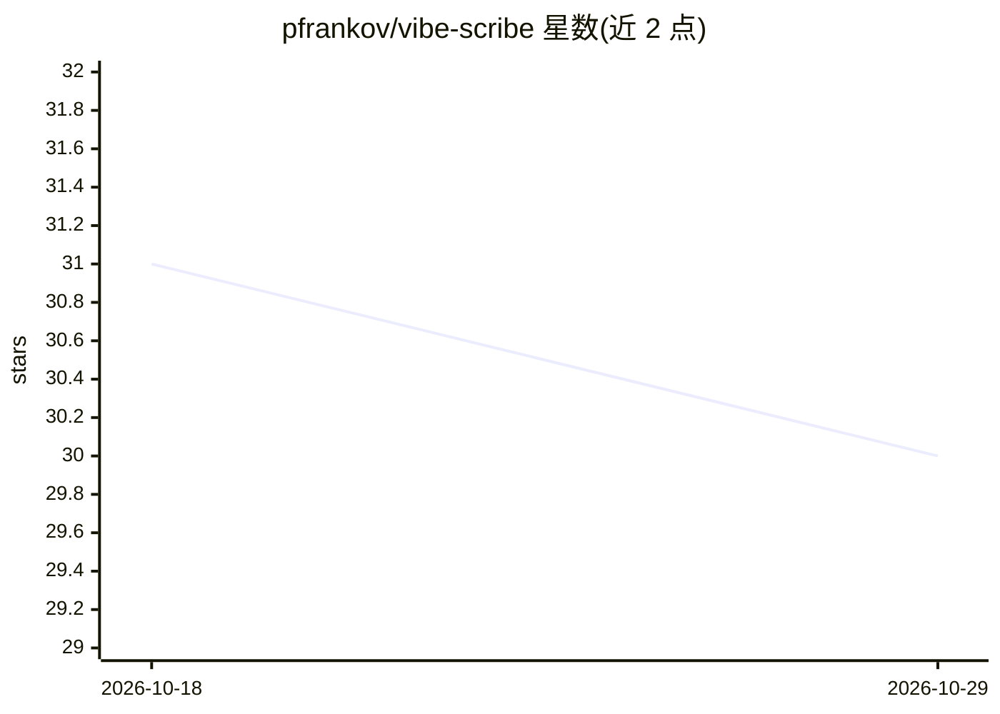

# pfrankov/vibe-scribe

⭐ 30 · Swift · MIT · 推送 2026-10-25 · [GitHub](https://github.com/pfrankov/vibe-scribe) · 个人维护

**macOS 会议录音转写与 AI 摘要应用**

VibeScribe 是一个 macOS 菜单栏应用，录制任意应用（Zoom、Meet、Teams 等）中的会议音频并生成与对话同语言的摘要。转写默认通过 FluidAudio 在本机运行（模型首次使用时下载），也可选 Apple 原生语音识别或 WhisperServer、OpenAI Whisper API 等服务器端方案；摘要通过任意 OpenAI 兼容端点（推荐本地 Ollama）完成。支持拖拽导入音视频文件转写摘要、自动命名笔记、更换模型重跑。要求 macOS 26+，通过 GitHub Releases 提供 zip 安装包或 Xcode 源码构建。

## 筛选速览

| 维度 | 判定 | 备注 |
|---|---|---|
| AI 角色 | `ai-native` | 本体是模型或模型工具 |
| 许可风险 | `permissive` | MIT |
| 部署形态 | `desktop` | 安装包/桌面程序 |
| 模型依赖 | local-ok | 支持本地模型 |
| 硬件要求 | — | 无带数字的原话,不猜 |
| 安装摩擦 | `medium` | 含编译或系统依赖之一 |
| 成熟度 | — | 结构信号不足 |

## 能力要点

- 录制任意应用音频并生成同语言摘要
- 默认 FluidAudio 本机转写，无需 Whisper 服务器或 API key
- 摘要支持任意 OpenAI 兼容端点（含本地 Ollama）
- 拖拽导入音视频文件转写与摘要，自动为笔记命名

## 适用场景

- 会议、访谈、头脑风暴后自动获得转写文本和摘要
- 导入已有音视频文件进行转写和摘要
- 完全本地化处理录音内容（本地转写+本地摘要服务）

## 场景标签

`语音识别` `AI 写作` · 领域:内容生成

## 证据(README 行号)

> L6: VibeScribe is a macOS app that records your meetings from any app and turns them into smart summaries using AI.
> L10: - Record a meeting from any app (Zoom, Meet, Teams, Discord, Slack, or others) and get a summary in the same langua
> L27: 5. VibeScribe transcribes the saved audio and creates a summary with your configured summary model.

## 星数曲线

2026-10-18 31 → 2026-10-29 30（-1）

---
*卡片 v1 · prompt 1.4 · 生成 2026-10-26 · 置信度 high · 依据 README sha `0efdd826924c` · [字段定义](../../DATASET.md)*
