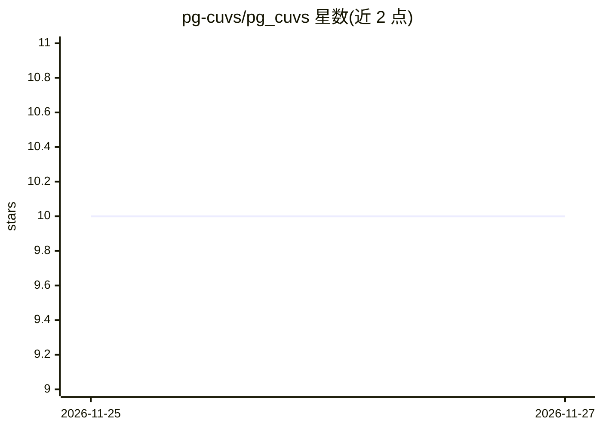

# pg-cuvs/pg_cuvs

⭐ 10 · C · PostgreSQL · 推送 2026-11-26 · [GitHub](https://github.com/pg-cuvs/pg_cuvs) · 个人维护

**PostgreSQL 的 GPU 向量检索扩展：由 NVIDIA cuVS 加速候选生成**

构建在 pgvector 与 RAPIDS cuVS 之上的 PostgreSQL 扩展：GPU 作为候选生成器返回 top-K TID 候选，PostgreSQL 保持控制面（SQL 语法、MVCC、可见性检查、join 与过滤）。提供两种模式——GPU 检索层（常驻 CAGRA、flat 暴力检索、压缩 IVF-PQ 索引）与 GPU 构建加速层（GPU 构建 CAGRA 后导出为 pgvector HNSW，在线服务留在 CPU）。通过 sidecar 守护进程共享 GPU 资源，各后端为普通进程。面向 Linux + PostgreSQL 16，需 pgvector 0.7.0+。定位为 pgvector 之上的加速层而非替代品。

## 筛选速览

| 维度 | 判定 | 备注 |
|---|---|---|
| AI 角色 | `ai-ecosystem` | LLM/agent 周边工具 |
| 许可风险 | `viral` | PostgreSQL |
| 部署形态 | `None` |  |
| 模型依赖 | — | README 未给出锁定关系 |
| 硬件要求 | — | 无带数字的原话,不猜 |
| 安装摩擦 | `high` | 编译与系统依赖俱全 |
| 成熟度 | `idea` | |

## 能力要点

- GPU 检索层支持常驻 CAGRA、flat 暴力、压缩 IVF-PQ 三类索引
- GPU 构建加速器可将 CAGRA 构建导出为 pgvector 可服务的 HNSW 索引
- sidecar 守护进程跨会话共享 GPU，后端无 CUDA 上下文
- 支持单守护进程内多 GPU sharding（shard_count）

## 适用场景

- 自建 RAG 系统中为 Postgres 向量检索加 GPU 加速
- 复用已有的嵌入模型 GPU 服务器做索引构建加速、在线查询留在 CPU
- 大规模向量索引需要快速构建或重建的场景

## 场景标签

`向量数据库` · 领域:知识与检索

## 证据(README 行号)

> L7: GPU-accelerated vector search for PostgreSQL via NVIDIA cuVS: a heterogeneous acceleration path that keeps Postgres 
> L31: pg_cuvs is **not** a replacement for pgvector. It is a GPU acceleration layer that sits on top of pgvector's interf
> L55: - **GPU search tier**: use resident CAGRA, flat brute-force, or compressed IVF-PQ indexes as GPU candidate generato

## 星数曲线

2026-11-25 10 → 2026-11-27 10（+0）

---
*卡片 v1 · prompt 1.4 · 生成 2026-11-24 · 置信度 high · 依据 README sha `560eb60af988` · [字段定义](../../DATASET.md)*
