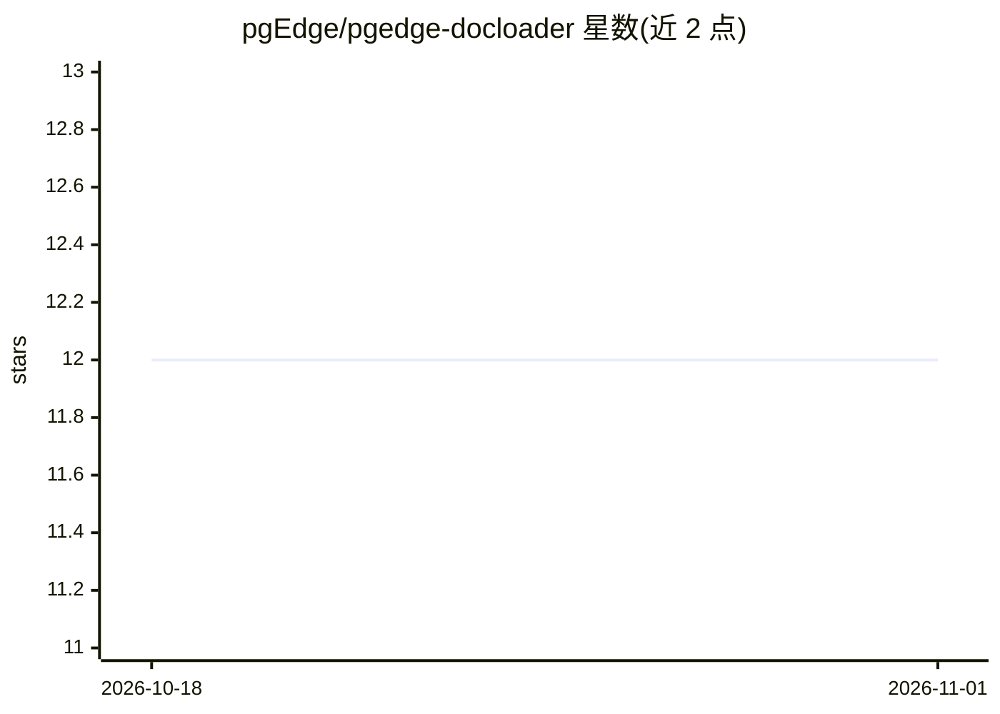

# pgEdge/pgedge-docloader

⭐ 12 · Go · PostgreSQL · 推送 2026-10-29 · [GitHub](https://github.com/pgEdge/pgedge-docloader) · [官网](https://docs.pgedge.com/pgedge-docloader) · 组织维护

**命令行工具：将 HTML/RST 等文档转为 Markdown 并载入 PostgreSQL**

pgEdge 维护的 Go 命令行工具，把 HTML、Markdown、reStructuredText 与 DocBook SGML/XML 文档统一转换为 Markdown，连同标题、文件名、时间戳等元数据加载到 PostgreSQL 数据库。支持单文件、目录、glob 模式与 Git 仓库 URL 作为输入，提供 YAML 配置文件、自定义元数据列、更新模式与事务化处理（失败自动回滚）。运行需预装 Go 1.23+ 与 PostgreSQL 14+，通过 git clone 后 make build 编译安装，常用于为 RAG 场景准备文档数据。

## 筛选速览

| 维度 | 判定 | 备注 |
|---|---|---|
| AI 角色 | `ai-ecosystem` | LLM/agent 周边工具 |
| 许可风险 | `viral` | PostgreSQL |
| 部署形态 | `None` |  |
| 模型依赖 | — | README 未给出锁定关系 |
| 硬件要求 | — | 无带数字的原话,不猜 |
| 安装摩擦 | `medium` | 含编译或系统依赖之一 |
| 成熟度 | — | 结构信号不足 |

## 能力要点

- HTML/Markdown/RST/DocBook SGML 统一转换为 Markdown
- 支持 Git 仓库直接克隆并处理文档
- 元数据提取与自定义元数据列、更新模式
- 事务化处理，全部成功或自动回滚

## 适用场景

- 把多格式文档统一入库 PostgreSQL 供检索使用
- 为 RAG 流水线准备 Markdown 格式语料
- 从 Git 仓库批量同步文档到数据库

## 场景标签

`RAG` `文档解析` · 领域:知识与检索

## 证据(README 行号)

> L28: pgEdge Document Loader is a command-line tool for loading documents from various formats into PostgreSQL databases.
> L30: The pgEdge Document Loader automatically converts documents (HTML, Markdown, reStructuredText, and SGML/DocBook) to

## 星数曲线

2026-10-18 12 → 2026-11-01 12（+0）

---
*卡片 v1 · prompt 1.4 · 生成 2026-11-01 · 置信度 mid · 依据 README sha `a7fa866ab2e6` · [字段定义](../../DATASET.md)*
