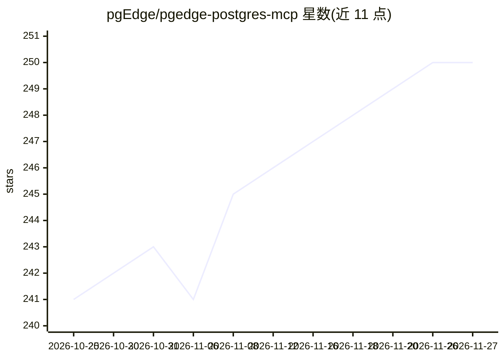

# pgEdge/pgedge-postgres-mcp

⭐ 250 · Go · PostgreSQL · 推送 2026-11-25 · [GitHub](https://github.com/pgEdge/pgedge-postgres-mcp) · [官网](https://docs.pgedge.com/pgedge-postgres-mcp-server) · 组织维护

**让 MCP 客户端用自然语言查询 PostgreSQL 的 MCP 服务器**

pgEdge 的 PostgreSQL MCP 服务器：通过 MCP 协议向兼容客户端暴露只读 SQL 查询、模式分析、BM25+MMR 混合检索与嵌入生成等工具，并提供自然语言生成 SQL 的 Agent CLI 与 React Web UI。支持 Claude Desktop/Cursor 等客户端接入、用户与令牌认证、TLS 与只读事务强制、Docker Compose 部署与配置热重载。README 明确声明不适用于面向公众的应用，仅限可信用户的内部环境。

## 筛选速览

| 维度 | 判定 | 备注 |
|---|---|---|
| AI 角色 | `ai-ecosystem` | LLM/agent 周边工具 |
| 许可风险 | `viral` | PostgreSQL |
| 部署形态 | `self-host` | docker 或自建部署 |
| 模型依赖 | — | README 未给出锁定关系 |
| 硬件要求 | — | 无带数字的原话,不猜 |
| 安装摩擦 | `low` | 无编译、无系统依赖或容器化 |
| 成熟度 | — | 结构信号不足 |

## 能力要点

- 通过 MCP 协议向兼容客户端提供只读 SQL 查询、模式分析与混合检索工具
- 自带 Go 命令行聊天客户端与 React Web UI，支持自然语言转 SQL
- Docker 镜像发布于 GitHub Container Registry，支持 Compose 部署
- 内置用户/令牌认证、TLS 与只读事务强制

## 适用场景

- 在 Claude Desktop 或 Cursor 中用自然语言查询内部 PostgreSQL 数据库
- 为开发者工作流搭建数据库探索与查询诊断助手
- 通过 Web UI 为团队提供基于对话的数据库访问

## 场景标签

`数据分析` · 领域:效率与自动化

## 证据(README 行号)

> L75: The pgEdge Postgres Model Context Protocol (MCP) server enables
> L77: clients. The Natural Language Agent provides supporting
> L117: - **Tools** - Query execution, schema analysis, advanced hybrid

## 星数曲线

2026-10-25 241 → 2026-11-27 250（+9）

---
*卡片 v1 · prompt 1.4 · 生成 2026-11-25 · 置信度 high · 依据 README sha `f9991fdbba97` · [字段定义](../../DATASET.md)*
