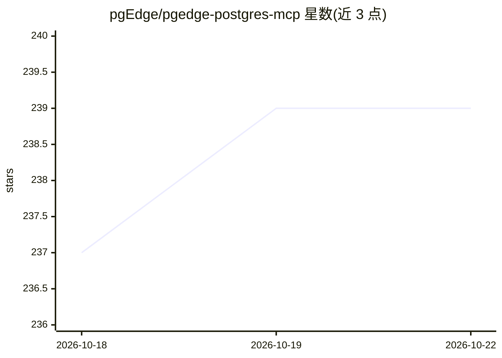

# pgEdge/pgedge-postgres-mcp

⭐ 239 · Go · PostgreSQL · 推送 2026-10-13 · [GitHub](https://github.com/pgEdge/pgedge-postgres-mcp) · [官网](https://docs.pgedge.com/pgedge-postgres-mcp-server) · 组织维护

**PostgreSQL MCP 服务器：让 LLM 客户端用自然语言查库**

用 Go 实现的 PostgreSQL MCP 服务器，通过 MCP 兼容客户端（CLI、Web UI、Claude Desktop/Code、Cursor、Windsurf、VS Code Copilot）执行 SQL 查询，Natural Language Agent 支持自然语言转 SQL。提供 MCP 工具（查询执行、schema 分析、BM25+MMR 混合搜索、嵌入生成）、资源、提示工作流、Go 聊天客户端与 React Web UI。默认只读事务，支持 TLS、用户/Token 认证、Docker 部署。README 明确声明不适用于面向公众的应用（LLM 可读取全部 schema 与数据）。要求 PostgreSQL 14+。

## 筛选速览

| 维度 | 判定 | 备注 |
|---|---|---|
| AI 角色 | `ai-ecosystem` | LLM/agent 周边工具 |
| 许可风险 | `viral` | PostgreSQL |
| 部署形态 | `self-host` | docker 或自建部署 |
| 模型依赖 | — | README 未给出锁定关系 |
| 硬件要求 | — | 无带数字的原话,不猜 |
| 安装摩擦 | `low` | 无编译、无系统依赖或容器化 |
| 成熟度 | — | 结构信号不足 |

## 能力要点

- MCP 工具集：查询执行、schema 分析、BM25+MMR 混合搜索、嵌入生成
- 默认只读事务保护，支持 TLS、用户/Token 认证与热重载
- 提供 Go 聊天客户端（含 Anthropic prompt caching）与 React Web UI
- Docker Compose 部署，预构建镜像发布于 GitHub Container Registry

## 适用场景

- 在 Claude Desktop/Cursor 等客户端中用自然语言查询 PostgreSQL
- 内部开发工作流中让 LLM 读取数据库 schema 与统计信息
- 通过浏览器 Web UI 与数据库对话式交互

## 场景标签

 · 领域:数据库/LLM 基础设施

## 证据(README 行号)

> L75: The pgEdge Postgres Model Context Protocol (MCP) server enables
> L76: SQL queries against PostgreSQL databases through MCP-compatible

## 星数曲线

2026-10-18 237 → 2026-10-22 239（+2）

---
*卡片 v1 · prompt 1.4 · 生成 2026-10-22 · 置信度 high · 依据 README sha `5cda659d83fc` · [字段定义](../../DATASET.md)*
