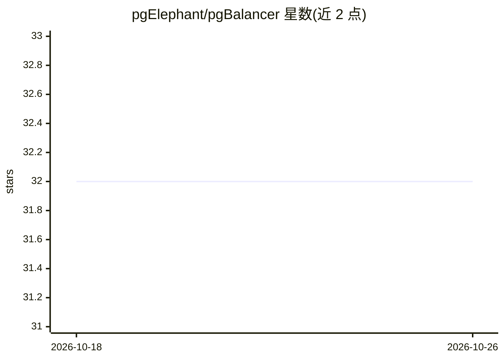

# pgElephant/pgBalancer

⭐ — · [GitHub]() · 个人维护

**pgpool-II 分支：带 AI 负载均衡的 PostgreSQL 连接池与负载均衡器**

pgpool-II 的分支，面向 PostgreSQL 13-18 提供连接池、负载均衡、高可用（自动故障转移与 watchdog）与查询缓存。核心新增：机器学习查询路由（健康评分、可调学习率/探索率）、17 个端点的 REST API（端口 8080，可选 JWT 认证）、MQTT 事件流、统一 CLI 工具 bctl（替代多个 pcp_* 命令）。配置兼容 pgpool-II 的 .conf 格式。源码编译安装，构建依赖 autoconf/automake/libtool/make/gcc 或 clang 及 PostgreSQL 开发头文件。

## 筛选速览

| 维度 | 判定 | 备注 |
|---|---|---|
| AI 角色 | `ai-enhanced` | 去掉 AI 部分产品仍成立 |
| 许可风险 | `none` | — |
| 部署形态 | `None` |  |
| 模型依赖 | — | README 未给出锁定关系 |
| 硬件要求 | — | 无带数字的原话,不猜 |
| 安装摩擦 | `low` | 无编译、无系统依赖或容器化 |
| 成熟度 | — | 结构信号不足 |

## 能力要点

- 机器学习查询路由与健康评分，参数（学习率/探索率/权重）可调
- 17 端点 REST API 作为子进程运行，可选 JWT 认证
- MQTT 事件流（节点状态/故障转移/健康检查）接入 Mosquitto/EMQX 等
- bctl CLI 统一替代 10+ 个 pcp_* 命令，支持 table/JSON 输出

## 适用场景

- 为多节点 PostgreSQL 集群做连接池与负载均衡
- 通过 REST API 或 CLI 远程管理集群节点与故障转移
- 将集群事件接入 MQTT 监控与告警体系

## 场景标签

 · 领域:数据库基础设施

## 证据(README 行号)

> L15: **pgbalancer** is an AI-based PostgreSQL load balancer and connection pooler that provides intelligent query routin
> L31: ### AI-Powered Load Balancing

## 星数曲线

2026-10-18 32 → 2026-10-26 32（+0）

---
*卡片 v1 · prompt 1.4 · 生成 2026-10-25 · 置信度 high · 依据 README sha `c4a35b798f90` · [字段定义](../../DATASET.md)*
