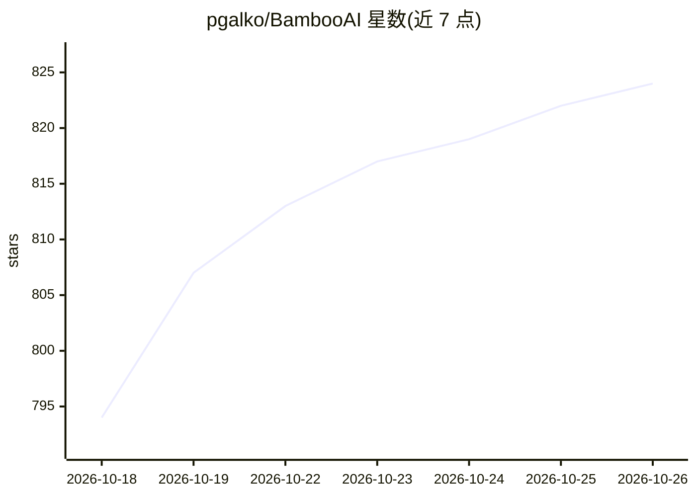

# pgalko/BambooAI

⭐ 824 · Python · MIT · 推送 2026-10-24 · [GitHub](https://github.com/pgalko/BambooAI) · 个人维护

**LLM 驱动的可复现数据分析环境，报告数字可溯源复算**

基于持久 Python 内核的 LLM 数据分析应用：主 Analyst 模型逐轮执行单一动作（运行代码单元、检索、阅读附件、提问或写报告），单元格保留在持久工作区供后续追问复用。数值结果与产生它的单元格绑定，报告完成后在新内核中重放以验证计算可复现性；Adaptive 模式可另配 Reviewer 模型审查证据。模型生成的代码默认在隔离 Docker 容器执行，支持 OpenRouter/OpenAI/Anthropic/Google/Groq/Mistral/xAI/DeepSeek 及 Ollama、vLLM 本地模型，各角色可配不同模型。提供 pip 安装与托管版 bambooai.org。

## 筛选速览

| 维度 | 判定 | 备注 |
|---|---|---|
| AI 角色 | `ai-native` | 本体是模型或模型工具 |
| 许可风险 | `permissive` | MIT |
| 部署形态 | `self-host` | docker 或自建部署 |
| 模型依赖 | local-ok | 支持本地模型 |
| 硬件要求 | — | 无带数字的原话,不猜 |
| 安装摩擦 | `low` | 无编译、无系统依赖或容器化 |
| 成熟度 | — | 结构信号不足 |

## 能力要点

- 持久 Python 内核中逐轮迭代分析，执行记录全程可查
- 报告完成后在新内核重放计算，验证数值可复现
- 数值结果与产生单元格绑定，结论可逐级溯源
- 各工作流角色（Analyst/Reviewer/Figures 等）可使用不同模型，含 Ollama/vLLM 本地模型

## 适用场景

- 上传 CSV/Parquet/JSON/XLSX 后用自然语言提问，得到可溯源的数据分析报告
- 对训练或生理数据做重复观测、不确定性与来源敏感的分析（集成 Intervals.icu/Endura/SweatStack）
- 把完成的分析保存为例行程式，无需再次调用模型即可在新数据上重跑
- 用本地开放权重模型（Ollama/vLLM）完成分析以满足数据不出网的要求

## 场景标签

`数据分析` · 领域:效率与自动化

## 证据(README 行号)

> L9: BambooAI is an LLM-driven data analysis environment built around a persistent Python kernel, an explicit analysis pr
> L15: At the end of a run, the relevant analysis is assembled and executed again against the original data in a fresh ker
> L41: * **Model-independent orchestration.** Analyst, Reviewer, Figures, Rewriter, Reader and the other workflow roles ca

## 星数曲线

2026-10-18 794 → 2026-10-26 824（+30）

---
*卡片 v1 · prompt 1.4 · 生成 2026-10-21 · 置信度 mid · 依据 README sha `d0f5ac33e420` · [字段定义](../../DATASET.md)*
