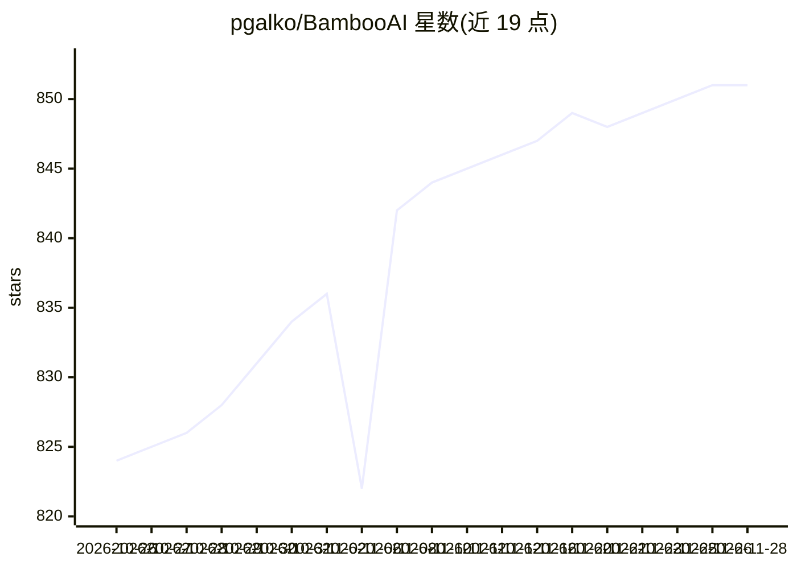

# pgalko/BambooAI

⭐ 851 · Python · MIT · 推送 2026-11-27 · [GitHub](https://github.com/pgalko/BambooAI) · [官网](bambooai.org) · 个人维护

**透明可复现的 AI 数据分析工作台：代码与证据全程可查**

BambooAI 以 LLM Analyst 在持久 Python 内核中探索数据集、编写并执行代码、迭代完成分析，用户可逐步查看、追问或分支。它记录完整计算轨迹（代码、输出、图表、模型交互、token 与成本），分析结束后在全新内核中重放计算以核验数值可复现性。Adaptive 模式引入独立 Reviewer 模型审问结论；Pathfinder 用于问题框定；完成的可分析转为可复用例程。模型可选商业或经 Ollama/vLLM 的本地权重模型，代码默认在隔离 Docker 容器中执行。

## 筛选速览

| 维度 | 判定 | 备注 |
|---|---|---|
| AI 角色 | `ai-native` | 本体是模型或模型工具 |
| 许可风险 | `permissive` | MIT |
| 部署形态 | `self-host` | docker 或自建部署 |
| 模型依赖 | local-ok | 支持本地模型 |
| 硬件要求 | — | 无带数字的原话,不猜 |
| 安装摩擦 | `low` | 无编译、无系统依赖或容器化 |
| 成熟度 | — | 结构信号不足 |

## 能力要点

- 分析过程完整记录：代码、输出、图表、中间结果与模型交互
- 在新内核中重放计算，核验报告数值的可复现性
- Adaptive 模式的独立 Reviewer 模型可质疑假设并要求补充测试
- 支持 OpenRouter、Anthropic 等商业模型及 Ollama/vLLM 本地模型

## 适用场景

- 对数据集提问并获得代码与证据可追溯的分析报告
- 需要数值结论可重放核验的统计分析工作
- 用本地开源权重模型进行数据分析
- 将已完成分析固化为例程应用到新数据集

## 场景标签

`数据分析` · 领域:效率与自动化

## 证据(README 行号)

> L9: BambooAI is an AI-powered data analysis workbench designed to make the analytical process transparent, reproducible 
> L11: At its core is an LLM Analyst working in a persistent Python environment. Given a dataset and a question, the Analy
> L69: The application supports a range of commercial and open-weight models, including locally hosted models served throu

## 星数曲线

2026-10-26 824 → 2026-11-28 851（+27）

---
*卡片 v1 · prompt 1.4 · 生成 2026-11-28 · 置信度 high · 依据 README sha `fd4c81d0b4b9` · [字段定义](../../DATASET.md)*
