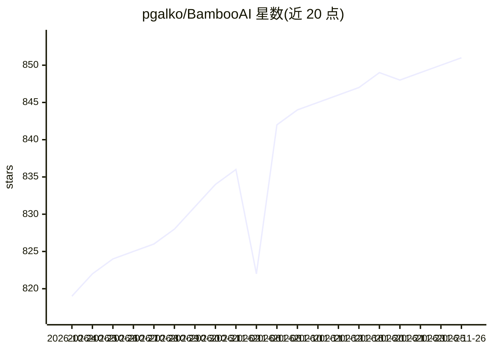

# pgalko/BambooAI

⭐ 851 · Python · MIT · 推送 2026-11-25 · [GitHub](https://github.com/pgalko/BambooAI) · [官网](bambooai.org) · 个人维护

**给分析师的可审查 AI 数据分析工作台**

BambooAI 以 LLM Analyst 在持久 Python 环境中探索数据集、编写并执行代码、迭代完成分析。记录完整计算过程（代码、输出、图表、中间结果、模型交互），数值结果与产生它的代码关联，分析结束后在全新 Python 内核重放以验证可复现性。Adaptive 模式引入独立 Reviewer 模型审查假设与证据；分析可转化为可复用例程应用到新数据集。支持商业与本地开放权重模型，Python 执行默认在隔离容器中运行。

## 筛选速览

| 维度 | 判定 | 备注 |
|---|---|---|
| AI 角色 | `ai-native` | 本体是模型或模型工具 |
| 许可风险 | `permissive` | MIT |
| 部署形态 | `self-host` | docker 或自建部署 |
| 模型依赖 | local-ok | 支持本地模型 |
| 硬件要求 | — | 无带数字的原话,不猜 |
| 安装摩擦 | `low` | 无编译、无系统依赖或容器化 |
| 成熟度 | — | 结构信号不足 |

## 能力要点

- 完整计算记录与代码溯源，全新内核重放验证数值可复现性
- Adaptive 模式中独立 Reviewer 模型审查分析过程
- 支持商业及本地开放权重模型（Ollama/vLLM）
- 完成的可分析可转为可复用例程，免 LLM 应用到新数据

## 适用场景

- 上传 CSV/Excel 等表格数据用自然语言提问并追踪 AI 分析过程
- 需要核验 AI 报告数值是否可复现的数据科学工作流
- 体育科学等需要反复测量与统计不确定性处理的领域数据分析
- 把已验证的分析固化为例程批量应用于新数据集

## 场景标签

`数据分析` · 领域:效率与自动化

## 证据(README 行号)

> L9: BambooAI is an AI-powered data analysis workbench designed to make the analytical process transparent, reproducible 
> L11: At its core is an LLM Analyst working in a persistent Python environment. Given a dataset and a question, the Analy
> L69: The application supports a range of commercial and open-weight models, including locally hosted models served throu

## 星数曲线

2026-10-24 819 → 2026-11-26 851（+32）

---
*卡片 v1 · prompt 1.4 · 生成 2026-11-26 · 置信度 high · 依据 README sha `924dfefd3694` · [字段定义](../../DATASET.md)*
