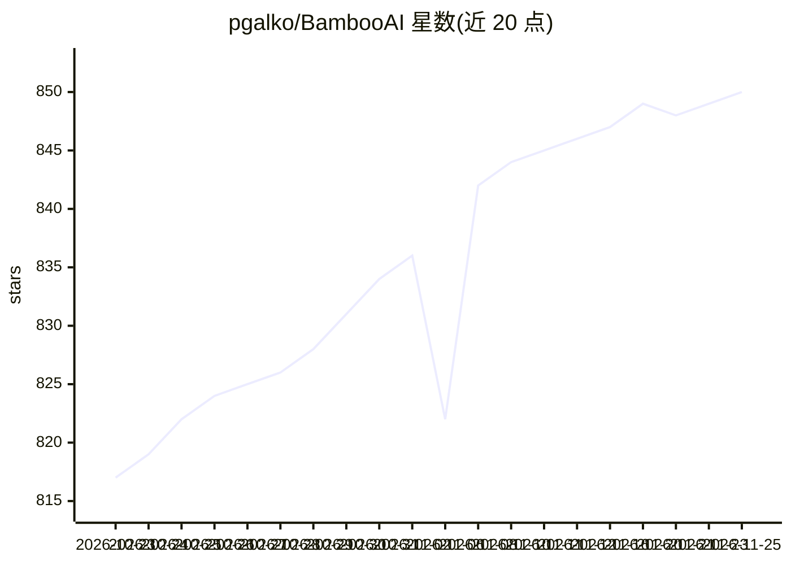

# pgalko/BambooAI

⭐ 850 · Python · MIT · 推送 2026-11-22 · [GitHub](https://github.com/pgalko/BambooAI) · [官网](bambooai.org) · 个人维护

**AI 数据分析工作台：过程可审查、结果可复现验证**

以 LLM Analyst 在持久 Python 内核中探索数据、写代码并迭代分析的交互式工作台。完整记录代码、输出、图表与模型交互，数值结论关联到产生它们的代码；分析结束后在全新内核重放计算以验证可复现性。可选 Reviewer 模型挑战假设，支持本地部署，代码在隔离 Docker 容器中执行，另提供托管版本。

## 筛选速览

| 维度 | 判定 | 备注 |
|---|---|---|
| AI 角色 | `ai-native` | 本体是模型或模型工具 |
| 许可风险 | `permissive` | MIT |
| 部署形态 | `self-host` | docker 或自建部署 |
| 模型依赖 | local-ok | 支持本地模型 |
| 硬件要求 | — | 无带数字的原话,不猜 |
| 安装摩擦 | `low` | 无编译、无系统依赖或容器化 |
| 成熟度 | — | 结构信号不足 |

## 能力要点

- LLM Analyst 在持久 Python 内核中迭代探索与执行代码
- 分析完成后在新内核重放计算验证数值可复现性
- Adaptive 模式中独立 Reviewer 模型定期审查分析过程
- 支持商业与开源权重模型，含 Ollama/vLLM 本地推理

## 适用场景

- 上传 CSV/Parquet 数据提出问题并跟踪分析过程
- 需要追溯每个数值结论的代码来源与证据
- 将完成的分析固化为可复用例程套用到新数据
- 用本地开源模型处理敏感数据集

## 场景标签

`数据分析` · 领域:效率与自动化

## 证据(README 行号)

> L9: BambooAI is an AI-powered data analysis workbench designed to make the analytical process transparent, reproducible 
> L69: The application supports a range of commercial and open-weight models, including locally hosted models served throu
> L75: Requirements: **Python 3.11 or newer**, with **Docker** running (Docker Desktop on macOS and Windows,

## 星数曲线

2026-10-23 817 → 2026-11-25 850（+33）

---
*卡片 v1 · prompt 1.4 · 生成 2026-11-24 · 置信度 high · 依据 README sha `4a8e15b2bce1` · [字段定义](../../DATASET.md)*
