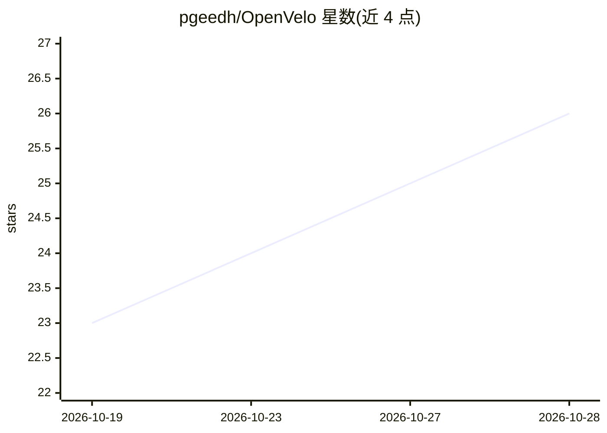

# pgeedh/OpenVelo

⭐ 26 · Python · 推送 2026-10-28 · [GitHub](https://github.com/pgeedh/OpenVelo) · 个人维护

**用手机视频做自行车 fitting 的开源本地姿态分析工具**

OpenVelo 是面向骑行者的开源 bike fitting 工具：读取 30 秒侧面骑行视频，用 MediaPipe Pose（可选 RTMPose）估计关节关键点，经两态 Viterbi 腿部身份跟踪、Hampel/Savitzky–Golay 清洗、鲁棒圆拟合求曲柄角、4 次谐波 Fourier 回归建模关节角随曲柄角的变化，输出膝/髋/躯干/肩/肘角度及 95% 置信区间（整圈 bootstrap），并基于骑手身高换算毫米级座垫高度调整，生成排序调整建议与 PDF 报告。全程本地运行，无账号、无云端 AI 服务。以 Python 源码提供，conda/venv + pip 安装，python app.py 启动。

## 筛选速览

| 维度 | 判定 | 备注 |
|---|---|---|
| AI 角色 | `ai-native` | 本体是模型或模型工具 |
| 许可风险 | `none` | — |
| 部署形态 | `library` | 以包/库形式分发 |
| 模型依赖 | — | README 未给出锁定关系 |
| 硬件要求 | — | 无带数字的原话,不猜 |
| 安装摩擦 | `low` | 无编译、无系统依赖或容器化 |
| 成熟度 | — | 结构信号不足 |

## 能力要点

- 视频→姿态关键点→腿部身份跟踪→角度(θ)谐波回归的测量流水线
- 关节角统计带 95% 置信区间（整圈 bootstrap，B=200）
- 由骑手身高换算毫米级座垫高度调整，含座垫高度模拟器
- 完全本地离线运行，无账号与云服务

## 适用场景

- 在家自助测量骑行姿态关节角度作为 fitting 基线
- 调整座垫/把立后复测对比调整前后数据
- 导出 PDF fitting 报告存档历史记录

## 场景标签

`图像视频处理` · 领域:感知与多模态

## 证据(README 行号)

> L10: **OpenVelo** turns a 30-second phone video of you pedalling into a professional bike fit. It tracks your joints, mo

## 星数曲线

2026-10-19 23 → 2026-10-28 26（+3）

---
*卡片 v1 · prompt 1.4 · 生成 2026-10-27 · 置信度 high · 依据 README sha `bdd46c5b3926` · [字段定义](../../DATASET.md)*
