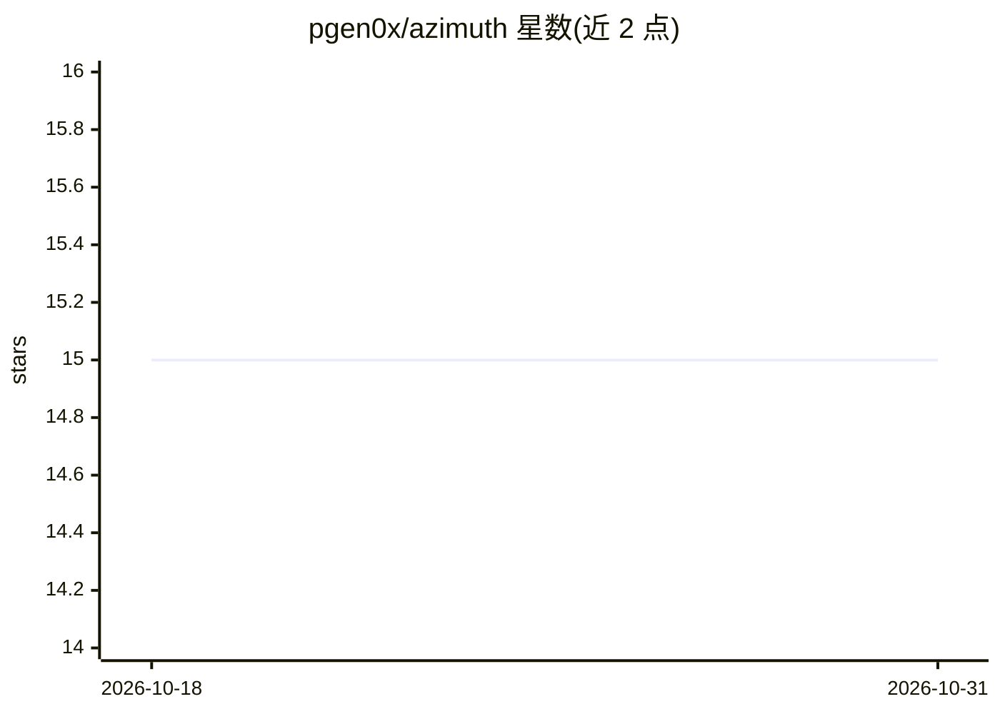

# pgen0x/azimuth

⭐ 15 · Python · MIT · 推送 2026-10-30 · [GitHub](https://github.com/pgen0x/azimuth) · 个人维护

**给 AI 交易代理的集中流动性池信号守护进程（Solana/Robinhood Chain）**

Go 编写的守护进程，持续监听 Meteora DLMM（Solana）与 Uniswap v3/v4（Robinhood Chain）的集中流动性池，经多层质量门（TVL、fee/TVL、市值、持有人、筹码集中度、铸币/冻结权限等）筛选后，以 HMAC 签名 webhook 把每轮全部合格池批量推送给构建于 Hermes 的 AI 交易代理，由其排序并部署。Solana 侧含自动退出监控（止损、追踪止盈、出区间平仓）；Robinhood Chain 侧退出循环默认禁用。声明交易真实资金、风险自担。通过 install.sh 一键安装并接入 Hermes profile。

## 筛选速览

| 维度 | 判定 | 备注 |
|---|---|---|
| AI 角色 | `ai-ecosystem` | LLM/agent 周边工具 |
| 许可风险 | `permissive` | MIT |
| 部署形态 | `None` |  |
| 模型依赖 | — | README 未给出锁定关系 |
| 硬件要求 | — | 无带数字的原话,不猜 |
| 安装摩擦 | `low` | 无编译、无系统依赖或容器化 |
| 成熟度 | — | 结构信号不足 |

## 能力要点

- 持续轮询发现 API 而非定时快照，每周期批量推送全部合格池
- Solana 四种筛选模式（casual/multiday/turnover/pulse）+ Robinhood Chain 四种（fresh/mature/ladder/usdg-ladder）
- 分层风险门控 + 0-100 Degen Score 信念评分 + PVP 同名币竞争检测
- 学习闭环：部署快照、结果日志与信号权重 darwinian 调整；Redis 可选去重存储

## 适用场景

- 让 AI 交易代理从批量候选池中自主挑选并部署 LP 仓位
- 自动化运行 Meteora DLMM 做市策略并管理退出
- 在 Robinhood Chain 上接收 Uniswap v3/v4 池的筛选信号

## 场景标签

`金融量化` · 领域:学习与行业

## 证据(README 行号)

> L10: **Azimuth** is a Go daemon that watches concentrated-liquidity pools across two
> L13: and hands an **AI trading agent** (built on
> L93:     A["azimuth (this Go daemon) poll → screen → dedup"] -->|"HMAC-signed POST /webhooks/dlmm-signal (batch 

## 星数曲线

2026-10-18 15 → 2026-10-31 15（+0）

---
*卡片 v1 · prompt 1.4 · 生成 2026-10-30 · 置信度 high · 依据 README sha `ed63a1626407` · [字段定义](../../DATASET.md)*
