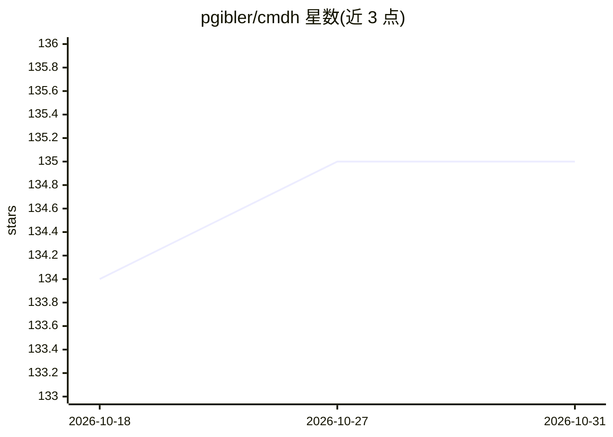

# pgibler/cmdh

⭐ 135 · TypeScript · MIT · 推送 2026-02-25 · [GitHub](https://github.com/pgibler/cmdh) · 个人维护

**在 shell 中用 LLM 将自然语言转换为 Linux 命令的工具**

cmdh（Command Helper）是一个 TypeScript 编写的命令行工具：用户输入自然语言命令请求，调用 ollama、OpenAI 或 text-generation-webui 提供的 LLM 生成对应的 Linux 命令，并通过热键菜单交互执行。生成前区分交互式与非交互式命令类型。安装方式为 git clone 后运行 install.sh，需要 NodeJS/npm/tsc 环境；使用前须通过 `cmdh configure` 向导选择并配置 LLM 主机（如 OpenAI key 或本地 ollama 拉取 codellama 模型）。

## 筛选速览

| 维度 | 判定 | 备注 |
|---|---|---|
| AI 角色 | `ai-native` | 本体是模型或模型工具 |
| 许可风险 | `permissive` | MIT |
| 部署形态 | `None` |  |
| 模型依赖 | local-ok | 支持本地模型 |
| 硬件要求 | — | 无带数字的原话,不猜 |
| 安装摩擦 | `low` | 无编译、无系统依赖或容器化 |
| 成熟度 | — | 结构信号不足 |

## 能力要点

- 自然语言生成 Linux 命令，支持命令链式组合
- 热键菜单交互执行生成的命令
- 区分交互式与非交互式 shell 命令
- 支持 OpenAI、ollama、text-generation-webui 三种 LLM 主机

## 适用场景

- 忘记命令或参数时快速查询生成
- 生成带管道与链式的复杂命令
- 在本地 ollama 模型上离线生成命令

## 场景标签

`代码生成` · 领域:编码与开发

## 证据(README 行号)

> L3: cmdh (short for Command Helper) is a tool that invokes LLM models provided by ollama or OpenAI to convert a command 
> L11: - Generate Linux commands from natural language

## 星数曲线

2026-10-18 134 → 2026-10-31 135（+1）

---
*卡片 v1 · prompt 1.4 · 生成 2026-10-22 · 置信度 high · 依据 README sha `a8829b0d98da` · [字段定义](../../DATASET.md)*
