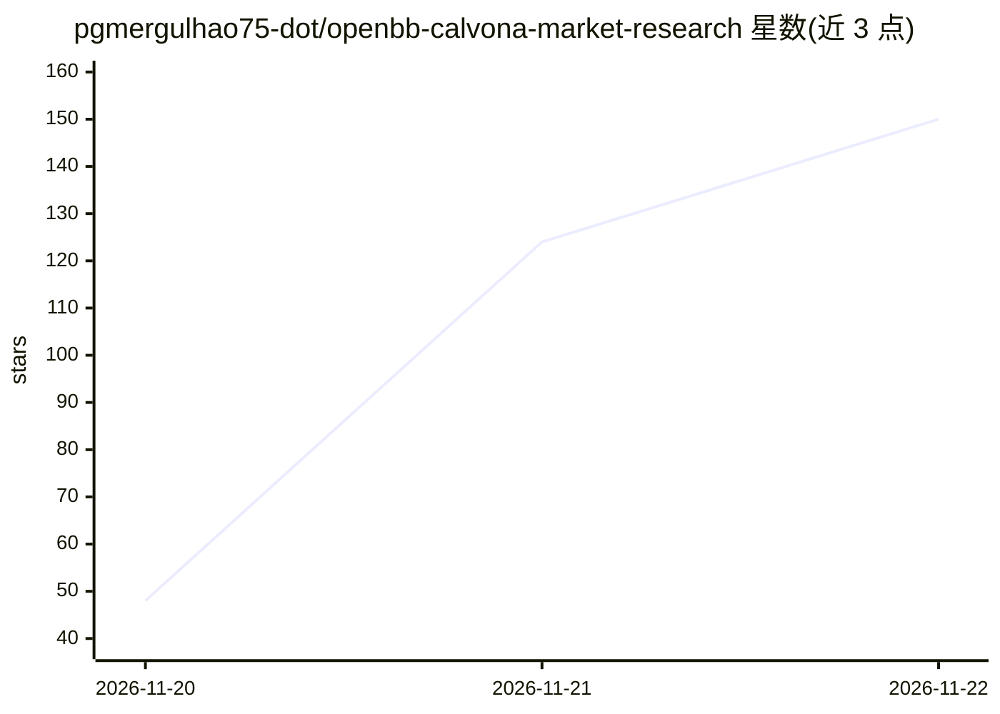

# pgmergulhao75-dot/openbb-calvona-market-research

⭐ 150 · TypeScript · 推送 2026-11-21 · [GitHub](https://github.com/pgmergulhao75-dot/openbb-calvona-market-research) · 个人维护

**面向量化分析师的多资产市场数据分析桌面工具**

基于 OpenBB Platform 构建的 Windows 桌面应用，用于检索、规范化和分析跨资产类别的市场数据：统一接入股票、固收、衍生品、外汇与宏观数据，提供确定性可复现的研究流水线、数据血缘审计、本地缓存与插件式数据源扩展。内置自选股管理、本地数据导入、图表对比、研究笔记、筛选与导出等模块。面向量化分析师与研究工程师，通过 PowerShell 脚本安装。

## 筛选速览

| 维度 | 判定 | 备注 |
|---|---|---|
| AI 角色 | `ai-enhanced` | 去掉 AI 部分产品仍成立 |
| 许可风险 | `none` | — |
| 部署形态 | `None` |  |
| 模型依赖 | — | README 未给出锁定关系 |
| 硬件要求 | — | 无带数字的原话,不猜 |
| 安装摩擦 | `low` | 无编译、无系统依赖或容器化 |
| 成熟度 | — | 结构信号不足 |

## 能力要点

- 统一接口聚合股票、固收、衍生品、外汇与宏观经济数据
- 确定性可复现研究流水线，含数据血缘与来源元数据
- 插件式 provider 架构可注册新数据源
- 自选股、导入、图表对比、笔记、筛选与导出的模块化工作台

## 适用场景

- 为多主题股票与指数维护持久化的本地自选股工作区
- 导入本地/vendor 数据并与自选股合并对比筛选
- 将研究笔记与具体标的和日期绑定并导出研究记录

## 场景标签

`金融量化` · 领域:学习与行业

## 证据(README 行号)

> L12: Openbb Calvona Market Research is a desktop application for retrieving, normalizing, and analyzing market data acro
> L45: Openbb Calvona Market Research operates as a modular research pipeline that sits on top of the OpenBB Platform. Eac

## 星数曲线

2026-11-20 48 → 2026-11-22 150（+102）

---
*卡片 v1 · prompt 1.4 · 生成 2026-11-20 · 置信度 low · 依据 README sha `c7e116252d32` · [字段定义](../../DATASET.md)*
